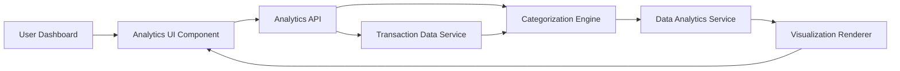

#### 1. High-Level Design

- **Summary:** This epic delivers comprehensive analytics with interactive visualizations of spending patterns across nine predefined categories (Food & Dining, Fuel, Shopping, Travel, Entertainment, Utilities, Healthcare, Education, Miscellaneous). Users can view monthly spend trends over time, identify patterns, and gain actionable insights through intuitive charts and graphs with at least 12 months of historical data.

- **Component Flow:**

- **Integration Points:**
  - **Upstream:** Transaction Data Service (raw transaction details and historical data)
  - **Downstream:** Categorization Engine (automatic transaction classification into 9 categories), Data Analytics Service (trend calculation, aggregation, and pattern analysis)

- **Key Assumptions:**
  - Transaction categorization uses machine learning model with 99% accuracy target; manual override capability exists but is out of scope for this epic.
  - Monthly trend calculations are pre-aggregated for the most recent 12 months and stored in optimized format for sub-3-second rendering.

- **NFR Highlights:** Analytics visualizations must render within 3 seconds, support filtering and drill-down capabilities, handle historical data for at least 12 months, and maintain 99% accuracy in transaction categorization.

#### 2. Validation Report

- **Requirements Coverage:** The design comprehensively covers all stated requirements including category-wise spending visualization across all nine categories, monthly spend trend analysis, interactive charts/graphs, spending pattern identification, and time-based comparison. The architecture supports the 3-second rendering requirement through pre-aggregation and efficient data structures. The 12-month historical data requirement and 99% categorization accuracy are explicitly addressed. All dependencies (Transaction Data Service, Categorization Engine, Data Analytics Service) are integrated into the component architecture.