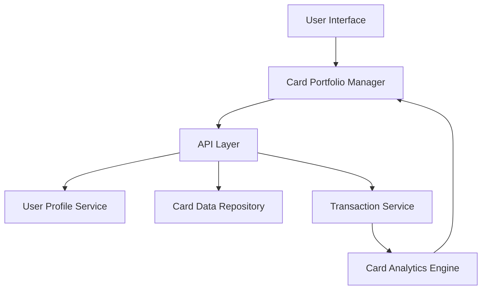

#### 1. High-Level Design

- **Summary:** This epic enables users to manage and view multiple credit cards (up to 10) within a unified interface, displaying detailed information for each card including credit limits, outstanding balances, and card-specific spending patterns. The feature provides card-wise spend analysis and comparison capabilities to optimize card usage decisions.

- **Component Flow:**

- **Integration Points:**
  - **Upstream:** User Profile Service (card ownership validation and user-card associations)
  - **Downstream:** Credit Card Data Repository (individual card details and metadata), Transaction Service (card-specific spending data and transaction history)

- **Key Assumptions:**
  - Card ownership is validated once per session; card list is cached client-side for performance.
  - Card-wise spend analysis aggregates transactions by card identifier with daily batch updates supplemented by near-real-time incremental updates.

- **NFR Highlights:** System must support display of at least 10 credit cards per user, card data retrieval must complete within 1 second, and interface must maintain performance with large transaction volumes per card.

#### 2. Validation Report

- **Requirements Coverage:** The design addresses all functional requirements including multiple card display, card-wise spend analysis, individual card details, comparison functionality, and credit limit/outstanding balance tracking per card. The architecture supports the 1-second retrieval requirement through efficient data access patterns and the 10-card minimum through scalable data structures. All specified integrations (Card Data Repository, User Profile Service, Transaction Service) are incorporated into the component flow.