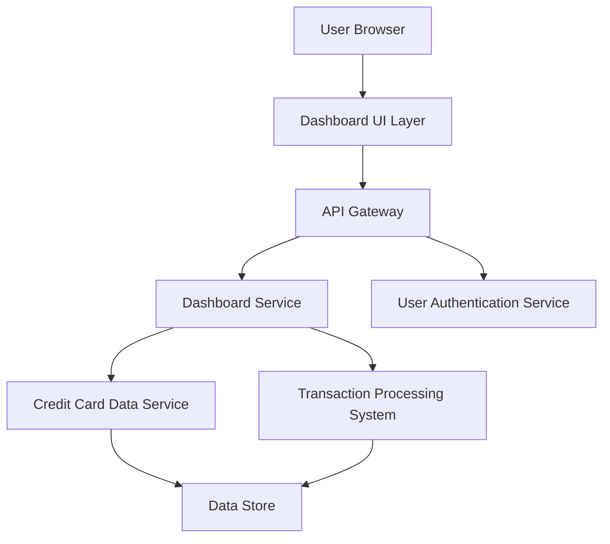

#### 1. High-Level Design

- **Summary:** This epic delivers a responsive dashboard that consolidates credit card portfolio health through four key performance indicators: Monthly Spend, Total Credit Limit, Available Credit, and Outstanding Amount. The dashboard provides real-time visibility into financial status across devices, enabling users to monitor their overall credit card health at a glance.

- **Component Flow:**

- **Integration Points:**
  - **Upstream:** User Authentication Service (secure access validation)
  - **Downstream:** Credit Card Data Service (card information retrieval), Transaction Processing System (spending calculations and aggregations)

- **Key Assumptions:** 
  - KPI calculations are performed server-side and cached for performance; data refresh occurs at configurable intervals (assumed every 5 minutes for real-time requirement).
  - Available Credit is calculated as (Total Credit Limit - Outstanding Amount) with no consideration for pending authorizations.

- **NFR Highlights:** Dashboard must load within 2 seconds, support responsive design for mobile and desktop, handle real-time data updates without page refresh, and support concurrent multi-user access.

#### 2. Validation Report

- **Requirements Coverage:** The design fully covers the epic's stated scope including all four KPIs (Monthly Spend, Total Credit Limit, Available Credit, Outstanding Amount), responsive layout, and real-time data refresh. The component architecture supports the 2-second load time requirement through caching and efficient data aggregation. Integration with specified dependencies (Credit Card Data Service, Transaction Processing System, User Authentication Service) is explicitly addressed in the architecture.