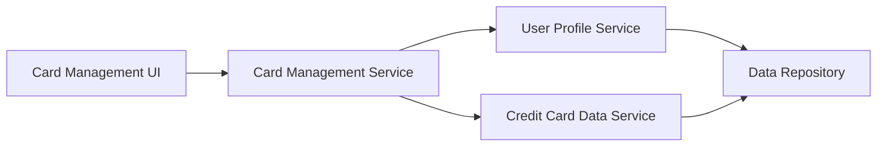

#### 1. High-Level Design

- **Summary:** This epic enables users to view and manage multiple credit cards (minimum 10 per user) within a unified dashboard interface. Users can view individual card details, track card-specific metrics, switch between cards for detailed analysis, and monitor each card's performance independently while maintaining a holistic portfolio view.

- **Component Flow:**

- **Integration Points:**
  - **Upstream:** User Profile Service (validates card ownership and user-card associations)
  - **Upstream:** Credit Card Data Service (retrieves individual and aggregated card information)
  - **Downstream:** Dashboard UI (displays card list and details)

- **Key Assumptions:** 
  - User Profile Service maintains the authoritative mapping of users to their registered credit cards.
  - Card switching functionality is client-side driven with backend APIs providing card-specific data on demand.

- **NFR Highlights:** System must support minimum 10 credit cards per user; Card list rendering must complete within 1 second; Data synchronization across cards must be consistent.

#### 2. Validation Report

- **Requirements Coverage:** The design covers all scope requirements including multiple credit card display, individual card details view, card-wise spend analysis, card selection/switching functionality, and card-specific tracking. Dependencies on User Profile Service and Credit Card Data Service are integrated. NFRs for supporting 10+ cards, 1-second rendering, and data consistency are addressed.