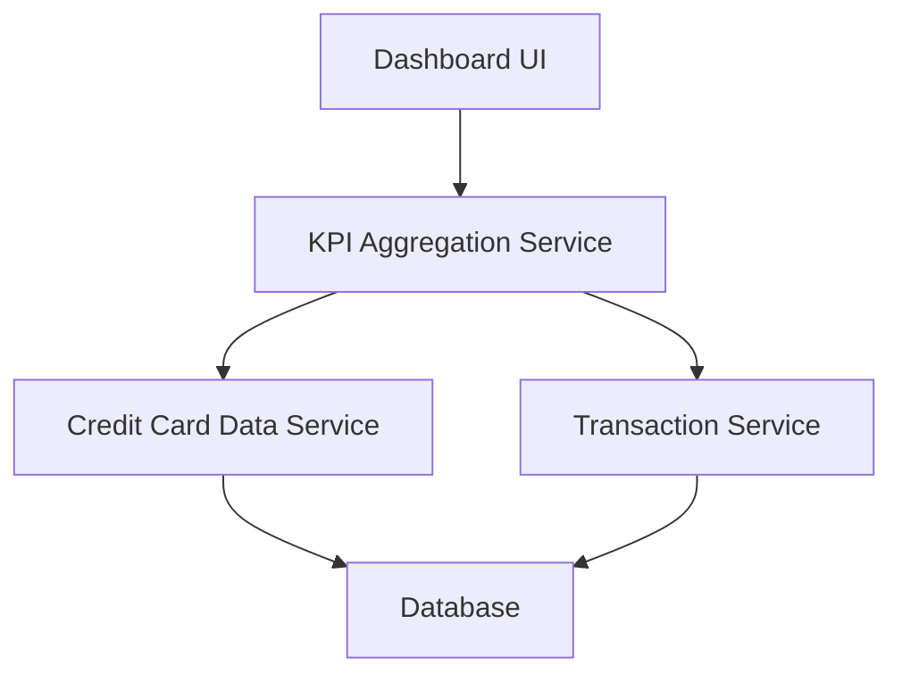

#### 1. High-Level Design

- **Summary:** This epic delivers a responsive dashboard serving as the central hub for credit card management. It provides consolidated KPIs including monthly spend, total credit limit, available credit, and outstanding amounts across all credit cards, enabling users to assess their financial position and credit utilization at a glance.

- **Component Flow:**

- **Integration Points:**
  - **Upstream:** Credit Card Data Service (retrieves card details and balances)
  - **Upstream:** Transaction Service (calculates monthly spend metrics)
  - **Downstream:** Responsive Web/Mobile UI (displays consolidated dashboard)

- **Key Assumptions:** 
  - KPI calculations (available credit, outstanding amounts) are computed in real-time or near-real-time by the aggregation service.
  - Credit Card Data Service provides a unified API to fetch multi-card data in a single call for performance optimization.

- **NFR Highlights:** Dashboard must load within 2 seconds; Support responsive design for mobile and desktop viewports; Handle real-time data updates for KPI metrics.

#### 2. Validation Report

- **Requirements Coverage:** The design addresses all scope elements including KPI display, monthly spend tracking, credit limit aggregation, available credit calculation, outstanding amount tracking, responsive layout, and multi-card consolidated view. Dependencies on Credit Card Data Service and Transaction Service are incorporated. NFRs for 2-second load time, responsive design, and real-time updates are explicitly covered.