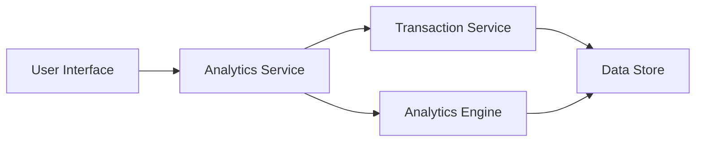

#### 1. High-Level Design

- **Summary:** This epic delivers interactive spending analytics that enable users to visualize and understand their credit card spending patterns across 9 predefined categories (Food & Dining, Fuel, Shopping, Travel, Entertainment, Utilities, Healthcare, Education, Miscellaneous). The solution provides monthly trend analysis and interactive charts to help users identify spending habits and make data-driven financial decisions.

- **Component Flow:**

- **Integration Points:**
  - **Upstream:** Transaction Service (provides transaction data and categorization)
  - **Upstream:** Analytics Engine (performs trend calculation and pattern recognition)
  - **Downstream:** Dashboard UI (displays visualizations and charts)

- **Key Assumptions:** 
  - Transaction categorization is performed automatically by the Transaction Service with predefined rules for the 9 categories.
  - Historical transaction data is retained for at least 12 months and is accessible via API calls.

- **NFR Highlights:** Analytics charts must render within 3 seconds; Support interactive filtering and drill-down capabilities; Handle historical data for at least 12 months of transactions.

#### 2. Validation Report

- **Requirements Coverage:** The design covers all stated scope items including category-wise visualization, monthly trends, interactive charts, transaction categorization, and multi-category support. The component flow addresses the dependencies on Transaction Service and Analytics Engine. NFRs for rendering performance (3 seconds), interactivity, and 12-month historical data handling are explicitly acknowledged in the architecture.