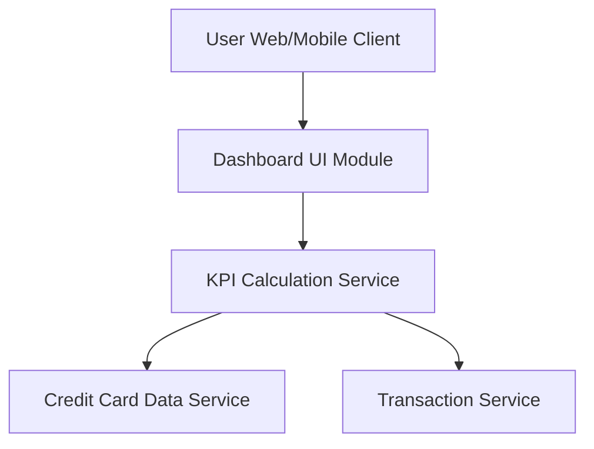

#### 1. High-Level Design

- **Summary:** This epic creates a centralized dashboard displaying key performance indicators (KPIs) for the user's credit card portfolio. Users can view consolidated financial metrics including monthly spend, total credit limit, available credit, and outstanding amounts across all cards in a single responsive interface, providing real-time visibility into financial health and credit utilization.

- **Component Flow:**

- **Integration Points:**
  - **Upstream:** Credit Card Data Service (retrieves card information, balances, credit limits)
  - **Upstream:** Transaction Service (provides transaction data for calculating monthly spend metrics)

- **Key Assumptions:** 
  - Real-time or near real-time data refresh is achieved through periodic polling or WebSocket connections; exact mechanism not specified.
  - KPI aggregation logic resides in a dedicated calculation service for separation of concerns.

- **NFR Highlights:** Dashboard must load within 2 seconds, support responsive design across desktop/tablet/mobile devices, UI must refresh KPI data in real-time or near real-time.

#### 2. Validation Report

- **Requirements Coverage:** The design addresses all scope items including dashboard interface design, monthly spend calculation and display, total credit limit aggregation, available credit computation, outstanding amount tracking, responsive layout implementation, and KPI visualization components. The architecture integrates with both Credit Card Data Service and Transaction Service as specified in dependencies. NFRs for performance (2-second load time), responsive design (multi-device support), and real-time data refresh are supported through the modular separation of the KPI Calculation Service, which can implement caching and optimization strategies to meet load time requirements while maintaining data freshness.