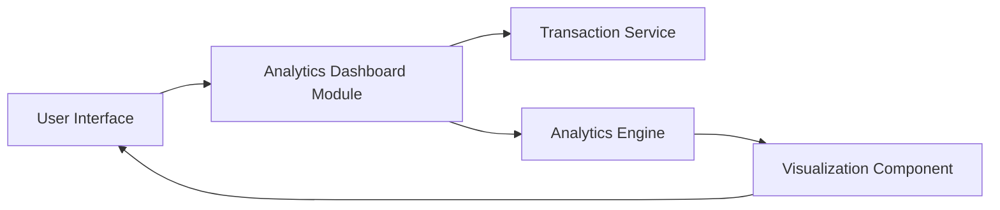

#### 1. High-Level Design

- **Summary:** This epic provides interactive analytics and visualization capabilities enabling users to understand spending patterns through monthly trend analysis and category-wise breakdowns. Users can analyze spending across nine predefined categories (Food & Dining, Fuel, Shopping, Travel, Entertainment, Utilities, Healthcare, Education, Miscellaneous) with visual charts and graphs to support budgeting and financial decision-making.

- **Component Flow:**

- **Integration Points:**
  - **Upstream:** Transaction Service (provides transaction data and category classification)
  - **Upstream:** Analytics Engine (performs trend calculation and pattern analysis)

- **Key Assumptions:** 
  - Transaction categories are pre-classified by the Transaction Service; no manual categorization required.
  - Historical data storage supports at least 12 months of transaction history as per NFR.

- **NFR Highlights:** Analytics visualizations must render within 3 seconds, support 12+ months of historical data analysis, charts must be interactive and responsive across all device sizes.

#### 2. Validation Report

- **Requirements Coverage:** The design covers all scope elements including category-wise spending visualization, monthly spend trend charts, interactive analytics dashboard, nine spending categories, spending pattern analysis, time-based trend tracking, and visual chart components. Integration with Transaction Service ensures access to categorized transaction data, while the Analytics Engine handles trend calculations and pattern analysis. NFRs for performance (3-second rendering), data retention (12 months), and responsive design are supported through the modular architecture separating data processing (Analytics Engine) from visualization (Visualization Component).