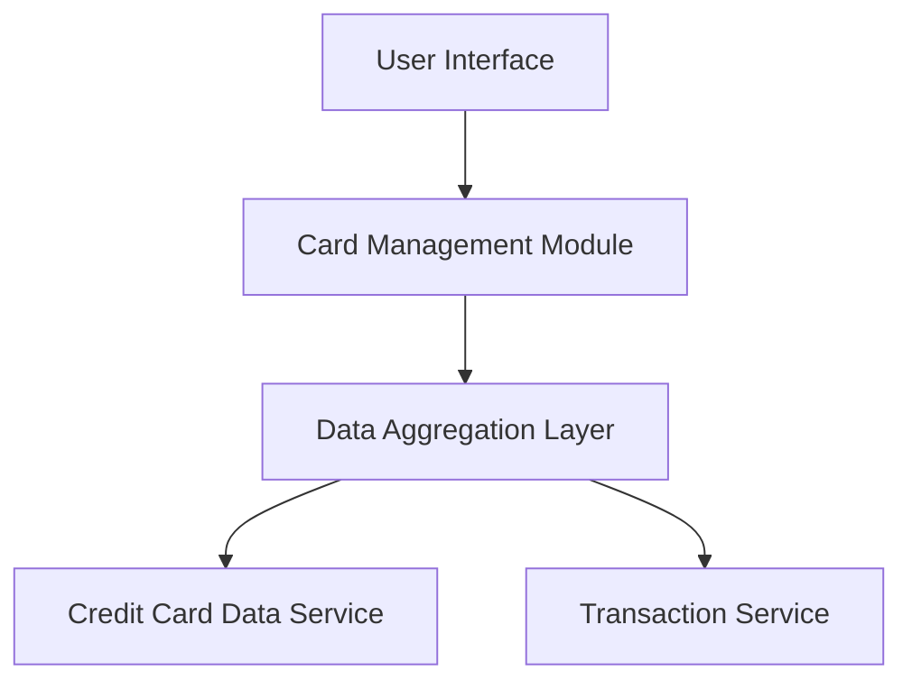

#### 1. High-Level Design

- **Summary:** This epic delivers a unified interface for users to view and manage multiple credit cards in one place. Users can access card-specific details, perform card-wise spend analysis, compare card utilization, and track spending patterns across their entire credit card portfolio without switching between multiple banking applications.

- **Component Flow:**

- **Integration Points:**
  - **Upstream:** Credit Card Data Service (for retrieving card information, limits, balances)
  - **Upstream:** Transaction Service (for card-specific spending data and transaction history)

- **Key Assumptions:** 
  - Card data is retrieved via REST APIs from backend services with JSON response format.
  - Card updates are event-driven or polling-based; refresh frequency not specified in epic.

- **NFR Highlights:** System must support at least 10 cards per user, card list rendering within 1 second, handle concurrent card data updates without performance degradation.

#### 2. Validation Report

- **Requirements Coverage:** The design addresses all stated scope items including multiple card display, card listing interface, card-wise spend analysis, individual card detail views, card selection/filtering, and comparison capabilities. The component flow ensures integration with required upstream services (Credit Card Data Service and Transaction Service) for data retrieval. NFRs for performance (1-second rendering) and scalability (10+ cards) are acknowledged in the architecture through the Data Aggregation Layer, which can optimize concurrent data fetching and caching strategies.