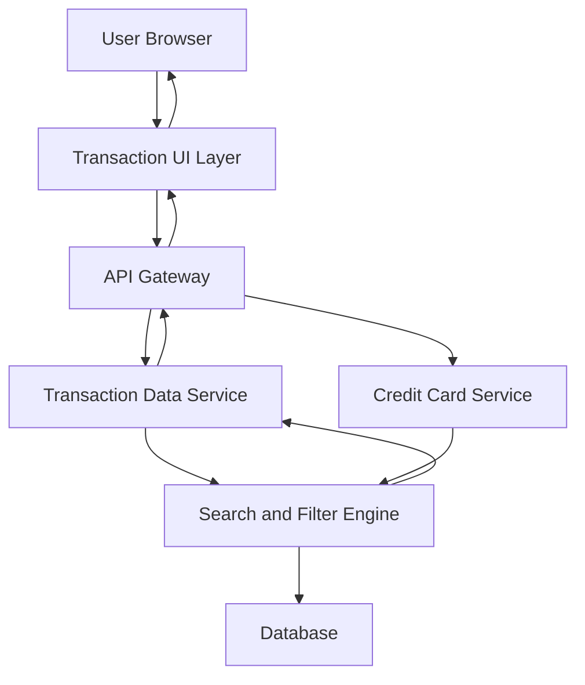

#### 1. High-Level Design

- **Summary:** This epic delivers comprehensive transaction tracking and management capabilities across multiple credit cards. The core requirement is to provide users with complete visibility into all credit card transactions through detailed history, search, and filtering capabilities. The scope includes transaction listing, card-wise segregation, transaction details view, and efficient query performance to support financial awareness and accountability.

- **Component Flow:**

- **Integration Points:** 
  - **Upstream:** Transaction Data Service for retrieving transaction records; Credit Card Service for mapping transactions to specific cards; Date/Time Service for transaction timestamps
  - **Downstream:** Search and Filter Engine for efficient query processing

- **Key Assumptions:** 
  - Transaction records include sufficient metadata (merchant name, category, amount, timestamp, card identifier) to support search and filtering operations
  - Database indexing is optimized to support sub-1-second query performance for high-volume transaction records

- **NFR Highlights:** System must handle high volume of transaction records efficiently; transaction queries must return results within 1 second; data integrity must be maintained for all financial transactions

- **Data Flow:** User requests transaction view with optional filters (date range, card, amount range, merchant). API Gateway routes request to Transaction Data Service, which coordinates with Credit Card Service to validate card ownership and Search and Filter Engine to apply query parameters. Search and Filter Engine queries Database with optimized indexes to retrieve matching transactions within 1-second SLA. Transaction records are enriched with card details and returned to Transaction UI Layer for display. User can view transaction details, apply additional filters, or search for specific transactions. All operations maintain data integrity through transactional database operations.

#### 2. Validation Report

- **Requirements Coverage:** The design fully addresses the epic's stated scope including transaction listing and display, transaction history across multiple cards, transaction search and filtering, transaction details view, and card-wise transaction segregation. All NFRs (efficient handling of high-volume records, sub-1-second query response time, data integrity maintenance) are addressed through the architecture with dedicated Search and Filter Engine and optimized database design. All stated dependencies (Transaction Data Service, Credit Card Service, Date/Time Service) are integrated into the component flow. Out-of-scope items (real bank integration, card payments, fund transfers, payment gateway integration, transaction disputes or chargebacks) are explicitly excluded from this design.