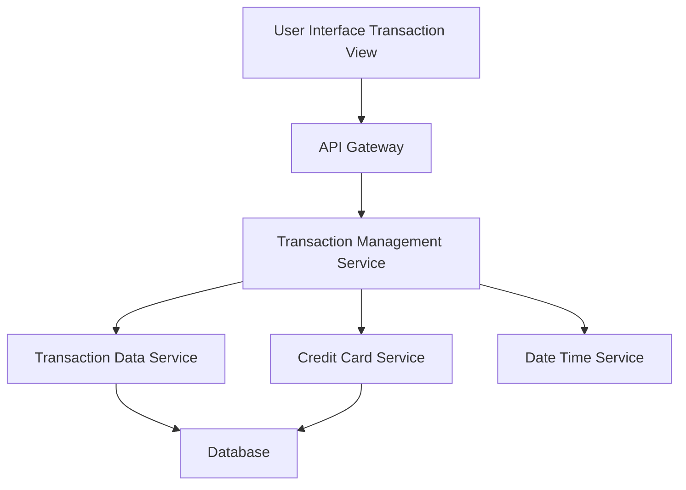

#### 1. High-Level Design

- **Summary**: This epic provides comprehensive transaction tracking capabilities allowing users to view, filter, and search all credit card transactions across multiple cards, with detailed transaction history and card-wise transaction segregation.

- **Component Flow**:

- **Integration Points**: 
  - **Upstream**: Transaction data service (for retrieving transaction records), Credit card service (for mapping transactions to specific cards), Date/time service (for transaction timestamps)
  - **Downstream**: Transaction listing UI with search, filter, and detail view capabilities

- **Key Assumptions**: 
  - Transaction records include merchant name, amount, date/time, category, and associated card ID.
  - Search and filter functionality supports queries by date range, card, merchant, amount range, and category.

- **NFR Highlights**: System must handle high volume of transaction records efficiently, Transaction queries must return results within 1 second, Data integrity must be maintained for all financial transactions.

- **Data Flow**: User accesses the transaction view and applies filters (date range, card, merchant, category). The Transaction Management Service queries the Transaction Data Service to retrieve matching transaction records, maps transactions to specific cards using the Credit Card Service, and formats timestamps using the Date/Time Service. Filtered and sorted transaction data is returned to the UI for display. User can select individual transactions to view detailed information.

#### 2. Validation Report

- **Requirements Coverage**: The design addresses all requirements including Transaction listing and display, Transaction history across multiple cards, Transaction search and filtering, Transaction details view, and Card-wise transaction segregation. Integration with transaction data service, credit card service, and date/time service is included. NFRs for handling high volume of transaction records efficiently, 1-second query response time, and data integrity are supported through indexed database queries, efficient data retrieval patterns, and transactional data management.