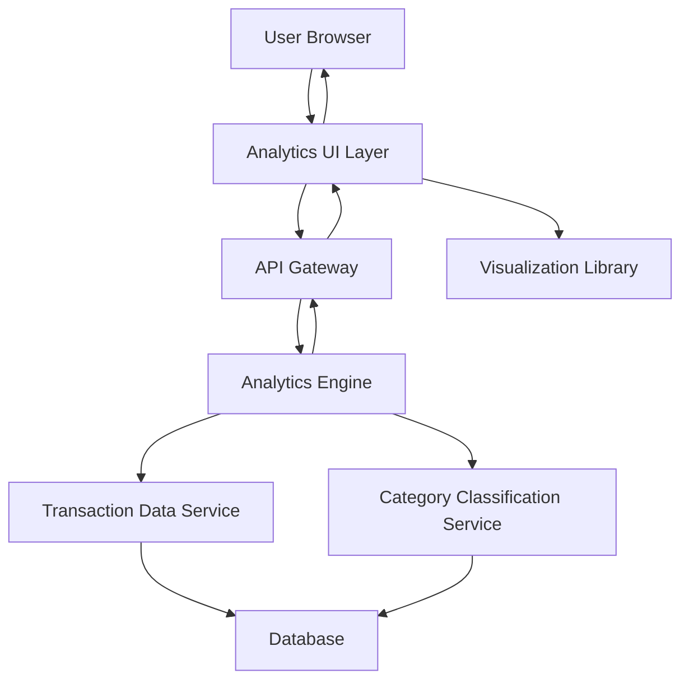

#### 1. High-Level Design

- **Summary:** This epic provides interactive spending analytics with category-wise breakdown and trend visualization capabilities. The core requirement is to enable users to analyze their credit card spending across nine predefined categories (Food & Dining, Fuel, Shopping, Travel, Entertainment, Utilities, Healthcare, Education, Miscellaneous) and view monthly spending trends. The scope includes card-wise analysis, interactive charts, and pattern identification to support informed financial decision-making.

- **Component Flow:**

- **Integration Points:** 
  - **Upstream:** Transaction Data Service for raw spending data; Category Classification Service for transaction categorization
  - **Downstream:** Analytics Engine for data aggregation and calculations; Visualization Library for rendering interactive charts

- **Key Assumptions:** 
  - Transactions are pre-classified into the nine spending categories or can be classified in real-time by the Category Classification Service
  - Historical transaction data is available for at least 12 months to enable meaningful monthly trend analysis

- **NFR Highlights:** Analytics visualizations must render within 3 seconds; system must support interactive charts with smooth user interactions; data aggregation must accurately calculate category totals and trends

- **Data Flow:** User requests spending analytics view. API Gateway routes request to Analytics Engine, which queries Transaction Data Service for all user transactions. Category Classification Service categorizes transactions into nine predefined categories. Analytics Engine aggregates data by category, card, and time period, calculating totals and trends. Processed data is returned to Analytics UI Layer, which uses Visualization Library to render interactive charts and graphs showing category-wise spending, monthly trends, and card-wise analysis. User can interact with visualizations to drill down into specific categories or time periods.

#### 2. Validation Report

- **Requirements Coverage:** The design comprehensively covers the epic's stated scope including category-wise spending analysis, monthly spend trends visualization, card-wise spend analysis, interactive charts and graphs, nine spending categories tracking, spending pattern identification, and comparative spend analysis. All NFRs (3-second render time, interactive charts with smooth interactions, accurate data aggregation) are addressed through the architecture with dedicated Analytics Engine and Visualization Library components. All stated dependencies (Transaction Data Service, Analytics Engine, Visualization Library, Category Classification Service) are integrated. Out-of-scope items (real bank integration, predictive forecasts, budget alerts, financial recommendations, third-party tools) are explicitly excluded from this design.