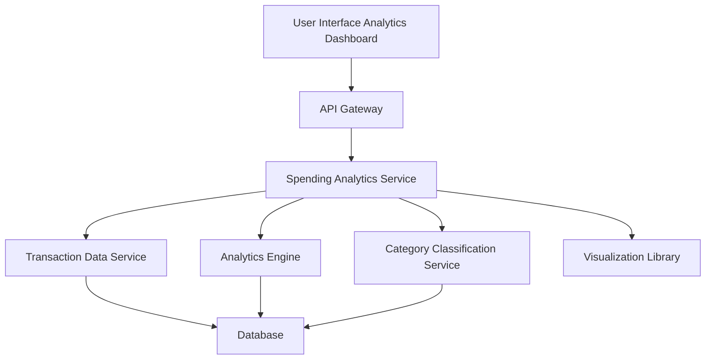

#### 1. High-Level Design

- **Summary**: This epic delivers interactive analytics and visualization capabilities for understanding spending patterns through category-wise analysis (nine categories: Food & Dining, Fuel, Shopping, Travel, Entertainment, Utilities, Healthcare, Education, Miscellaneous) and monthly spend trends, with card-wise spend analysis.

- **Component Flow**:

- **Integration Points**: 
  - **Upstream**: Transaction data service (for spending data), Analytics engine (for data aggregation and calculations), Visualization library (for interactive charts), Category classification service (for transaction categorization)
  - **Downstream**: Interactive analytics UI with charts, graphs, and drill-down capabilities

- **Key Assumptions**: 
  - Transactions are automatically categorized by the category classification service using predefined rules or ML models.
  - Analytics engine supports aggregation queries for category totals, monthly trends, and card-wise breakdowns.

- **NFR Highlights**: Analytics visualizations must render within 3 seconds, System must support interactive charts with smooth user interactions, Data aggregation must accurately calculate category totals and trends.

- **Data Flow**: User accesses the analytics dashboard and selects filters (date range, card, category). The Spending Analytics Service retrieves transaction data from the Transaction Data Service, processes it through the Analytics Engine to aggregate spending by category and time period, and uses the Category Classification Service to ensure proper categorization. Aggregated data is passed to the Visualization Library to generate interactive charts and graphs, which are displayed in the UI.

#### 2. Validation Report

- **Requirements Coverage**: The design covers all requirements including Category-wise spending analysis, Monthly spend trends visualization, Card-wise spend analysis, Interactive charts and graphs, Nine spending categories tracking, Spending pattern identification, and Comparative spend analysis. Integration with transaction data service, analytics engine, visualization library, and category classification service is addressed. NFRs for 3-second rendering, interactive charts with smooth interactions, and accurate data aggregation are supported through optimized data processing and visualization frameworks.