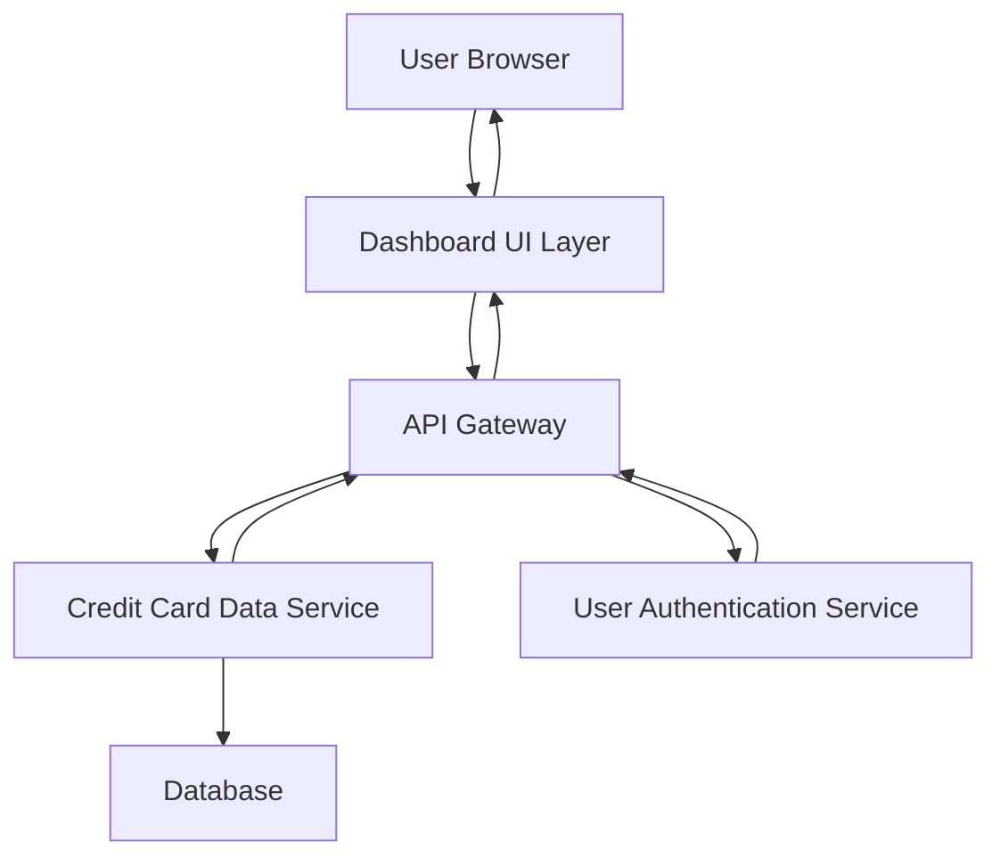

#### 1. High-Level Design

- **Summary:** This epic delivers a consolidated credit card dashboard that aggregates and displays key performance indicators across all user credit cards. The core requirement is to provide users with a single-view interface showing monthly spend, total credit limit, available credit, and outstanding amounts. The scope includes multi-card aggregation, real-time data refresh, and responsive UI design for desktop and mobile access.

- **Component Flow:**

- **Integration Points:** 
  - **Upstream:** User Authentication Service for secure access validation
  - **Downstream:** Credit Card Data Service for retrieving card information, balances, and financial metrics

- **Key Assumptions:** 
  - Credit card data is pre-aggregated or can be calculated on-demand within the 2-second load time requirement
  - All credit card accounts are linked to a single user profile accessible through the authentication service

- **NFR Highlights:** Dashboard must load within 2 seconds; must support responsive design across desktop and mobile devices; data refresh rate must be near real-time for accurate financial information

- **Data Flow:** User authenticates and requests dashboard view. API Gateway validates user session with Authentication Service, then queries Credit Card Data Service for all cards associated with the user. The service retrieves card details, balances, and transaction summaries from the database, calculates KPIs (monthly spend, available credit, outstanding amounts), and returns aggregated data. Dashboard UI renders KPIs in a responsive layout with near real-time refresh capability.

#### 2. Validation Report

- **Requirements Coverage:** The design fully covers the epic's stated scope including dashboard KPIs display, monthly spend tracking, total credit limit aggregation, available credit calculation, outstanding amount tracking, multiple credit card view, and responsive layout design. All NFRs (2-second load time, responsive design, near real-time refresh) are addressed through the architecture. The integration points align with stated dependencies (Credit Card Data Service and User Authentication Service). Out-of-scope items (real bank integration, payments, fund transfers, loans, payment gateway) are explicitly excluded from this design.