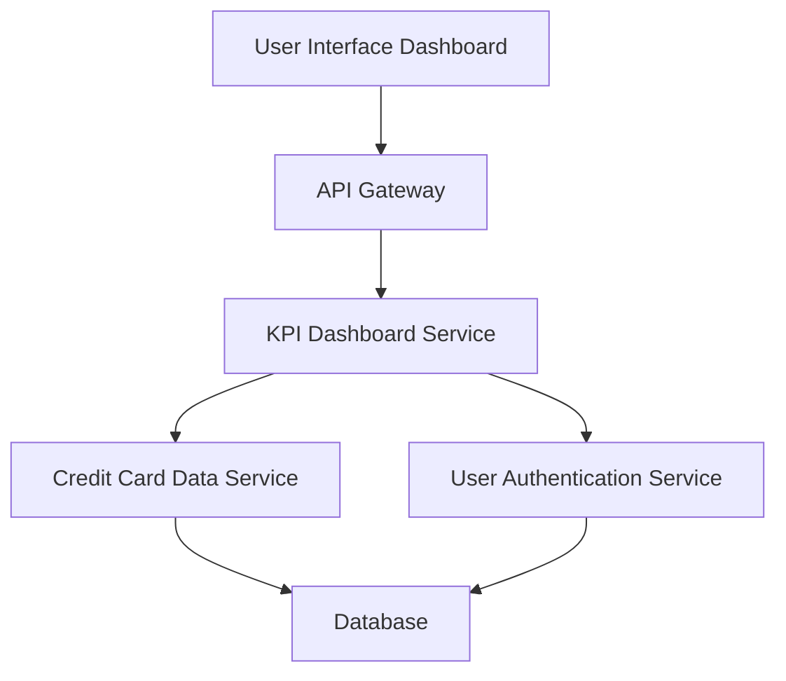

#### 1. High-Level Design

- **Summary**: This epic provides a consolidated overview dashboard displaying key performance indicators (monthly spend, total credit limit, available credit, outstanding amounts) aggregated across all credit cards, with a modern responsive interface for portfolio health monitoring.

- **Component Flow**:

- **Integration Points**: 
  - **Upstream**: Credit card data service (for retrieving card information and balances), User authentication service (for secure access to personal financial data)
  - **Downstream**: Dashboard UI (responsive web/mobile interface)

- **Key Assumptions**: 
  - KPIs are calculated in near real-time based on the latest available data.
  - Data refresh occurs automatically at regular intervals or on user request.

- **NFR Highlights**: Dashboard must load within 2 seconds, System must support responsive design across desktop and mobile devices, Data refresh rate must be near real-time for accurate financial information.

- **Data Flow**: Authenticated user accesses the dashboard, triggering the KPI Dashboard Service to query the Credit Card Data Service for all linked cards. The service aggregates balances, limits, and outstanding amounts, calculates KPIs (total credit limit, available credit, monthly spend, outstanding amount), and returns the data to the UI for display. The UI refreshes data periodically to maintain near real-time accuracy.

#### 2. Validation Report

- **Requirements Coverage**: The design addresses all requirements including Dashboard KPIs display, Monthly Spend tracking, Total Credit Limit aggregation, Available Credit calculation, Outstanding Amount tracking, Multiple credit card view, and Responsive layout design. Integration with credit card data service and user authentication service is included. NFRs for 2-second load time, responsive design, and near real-time data refresh are supported through efficient service architecture and caching strategies.