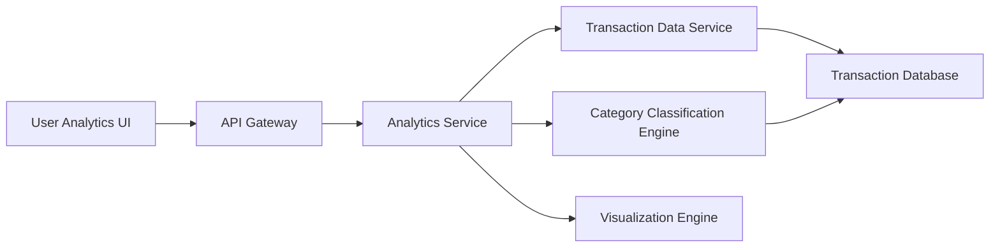

#### 1. High-Level Design

- **Summary:** This epic delivers comprehensive spending analytics through interactive visualizations and trend analysis. Users can analyze spending patterns via category-wise breakdowns (Food & Dining, Fuel, Shopping, Travel, Entertainment, Utilities, Healthcare, Education, Miscellaneous), monthly spend trends, and card-wise spend analysis. Interactive charts and graphs transform complex spending data into actionable insights for better financial management.

- **Component Flow:**

- **Integration Points:**
  - **Upstream:** Transaction Data Service (for retrieving transaction history); Category Classification Engine (for transaction categorization into predefined categories)
  - **Downstream:** Visualization Library/Engine (for rendering interactive charts and graphs); Transaction Database (for historical transaction data)

- **Key Assumptions:**
  - Transactions are pre-categorized or categorized in near real-time by the Category Classification Engine; visualization rendering occurs client-side using a JavaScript library.
  - Historical data for minimum 12 months is retained and indexed for efficient querying.

- **NFR Highlights:** Analytics visualizations must render within 1 second; support historical data analysis for minimum 12 months; handle minimum 1000 transactions per user efficiently.

- **Data Flow:** User accesses analytics interface → Analytics UI requests spending data via API Gateway → Analytics Service queries Transaction Data Service for user's transaction history (up to 12 months) → Category Classification Engine categorizes transactions into 9 predefined categories → Analytics Service aggregates data by category, month, and card → Aggregated data is sent to Analytics UI → Visualization Engine renders interactive charts (category breakdown, monthly trends, card-wise analysis) within 1 second → User interacts with visualizations to explore spending patterns and identify insights.

#### 2. Validation Report

- **Requirements Coverage:** The design fully addresses the epic's scope including category-wise spending visualization (9 categories), monthly spend trend analysis, card-wise spend analysis, interactive charts and graphs, spending pattern identification, multi-category spending breakdown, and transaction categorization. All NFRs are met: analytics visualizations rendering within 1 second, support for 12 months of historical data, and efficient handling of minimum 1000 transactions per user. Integration dependencies with transaction data service, category classification engine, and visualization library are explicitly incorporated. Out-of-scope items (real bank integration, payments, fund transfers, loans, payment gateway, predictive analytics, budget alerts) are correctly excluded from the design.