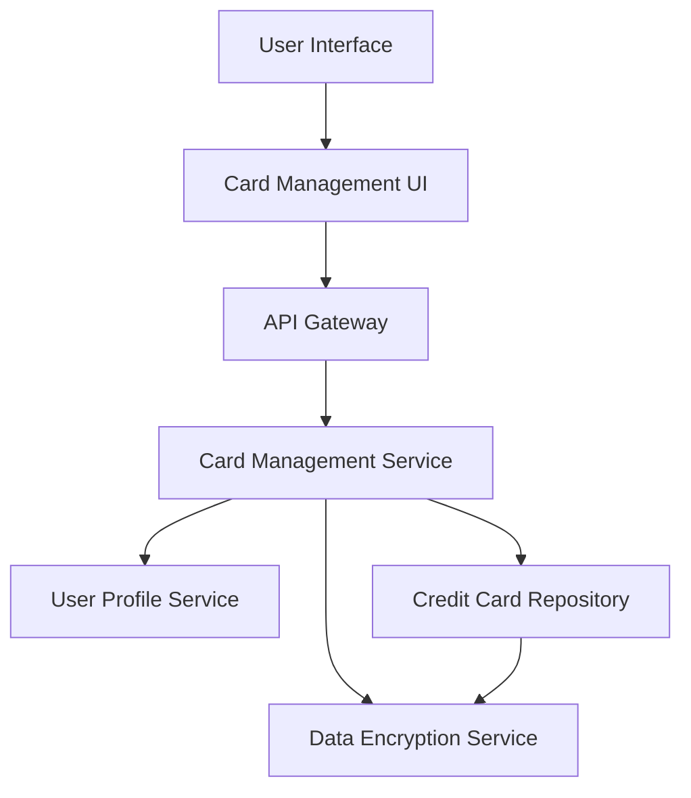

#### 1. High-Level Design

- **Summary:** This epic enables users to manage and view multiple credit cards within a single dashboard interface. Users can see all their credit cards with individual card details including card-specific limits, balances, and usage. The feature supports adding, viewing, and organizing multiple credit cards, providing a comprehensive overview of the user's entire credit card portfolio from different issuers.

- **Component Flow:**

- **Integration Points:**
  - **Upstream:** User Profile Service (for associating cards with user accounts and managing user-card relationships)
  - **Downstream:** Credit Card Repository (for storing and retrieving card information); Data Encryption Service (for secure card information handling and masking card numbers)

- **Key Assumptions:**
  - Card data is stored with encryption at rest; card numbers are masked (e.g., showing last 4 digits only) in the UI.
  - Card addition/organization operations are synchronous with immediate feedback to the user.

- **NFR Highlights:** System must support minimum 10 credit cards per user; card data retrieval latency under 500ms; secure storage and display with masked card numbers.

- **Data Flow:** User accesses card management interface → Card Management UI requests card list via API Gateway → Card Management Service queries User Profile Service to retrieve user's associated cards → Card Management Service fetches card details from Credit Card Repository → Data Encryption Service decrypts card data and applies masking rules → Card Management Service returns card list with masked card numbers, individual limits, and balances → Card Management UI displays organized card list with card-specific details → User can add/view/organize cards with changes persisted to Credit Card Repository via Card Management Service.

#### 2. Validation Report

- **Requirements Coverage:** The design comprehensively covers the epic's scope including multiple credit card display, card-specific details view, card list management, individual card limit tracking, card-wise balance display, and card organization interface. All NFRs are addressed: support for minimum 10 cards per user, card data retrieval latency under 500ms, and secure storage with masked card numbers through the Data Encryption Service. Integration dependencies with credit card repository, user profile service, and data encryption service are explicitly included. Out-of-scope items (real bank integration, payments, fund transfers, loans, payment gateway) are correctly excluded.