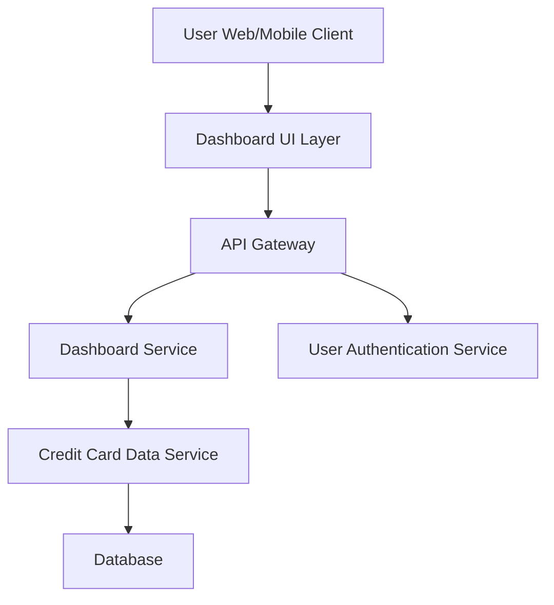

#### 1. High-Level Design

- **Summary:** This epic delivers a consolidated dashboard that displays key performance indicators (KPIs) for a user's credit card portfolio, including monthly spend, total credit limit, available credit, and outstanding amounts. The dashboard provides real-time visibility into credit card financial health through a modern, responsive interface accessible across desktop, tablet, and mobile devices.

- **Component Flow:**

- **Integration Points:**
  - **Upstream:** User Authentication Service (for secure user access and session management)
  - **Downstream:** Credit Card Data Service (for retrieving card balances, transaction data, and KPI calculations)

- **Key Assumptions:**
  - Credit card data is available via RESTful API with JSON format; KPI metrics are calculated server-side and refreshed on-demand or via polling mechanism.
  - User session management and token-based authentication are already in place.

- **NFR Highlights:** Dashboard must be responsive (desktop/tablet/mobile); page load time under 2 seconds; support real-time data refresh for KPI metrics.

- **Data Flow:** User authenticates via Authentication Service → Dashboard UI requests KPI data via API Gateway → Dashboard Service queries Credit Card Data Service → Credit Card Data Service retrieves aggregated data (monthly spend, credit limits, available credit, outstanding amounts) from Database → Data is returned to Dashboard Service → Dashboard Service formats and returns KPIs to UI → Dashboard UI renders KPIs in responsive layout with real-time refresh capability.

#### 2. Validation Report

- **Requirements Coverage:** The design fully covers the epic's stated scope including dashboard KPI display, monthly spend tracking, total credit limit aggregation, available credit calculation, outstanding amount display, responsive UI design, and multi-card consolidated view. All NFRs (responsiveness, page load time under 2 seconds, real-time refresh) are addressed through the architecture. Integration dependencies with credit card data service and user authentication service are explicitly incorporated. Out-of-scope items (real bank integration, payments, fund transfers, loans, payment gateway) are correctly excluded from the design.