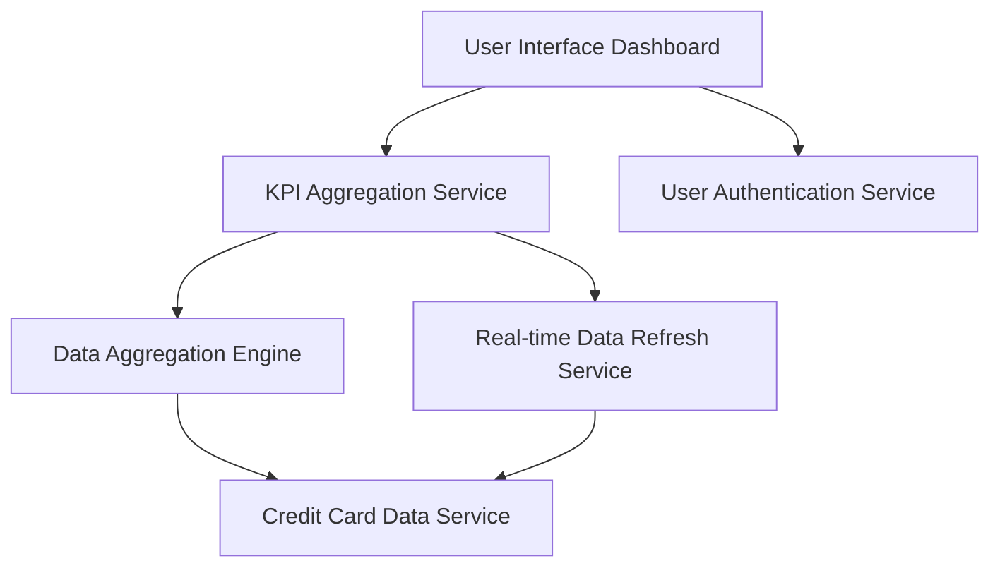

#### 1. High-Level Design

- **Summary:** This epic delivers a comprehensive dashboard interface providing real-time visibility into critical financial metrics across all credit cards, including monthly spend, total credit limit, available credit, and outstanding amounts. The dashboard serves as the primary landing page for credit card financial health monitoring.

- **Component Flow:**

- **Integration Points:**
  - **Upstream:** User Authentication Service (for user session and access control)
  - **Downstream:** Credit Card Data Service, Data Aggregation Engine for multi-card calculations

- **Key Assumptions:**
  - KPI metrics are calculated on-demand with caching for frequently accessed data to meet 2-second load time requirement.
  - Real-time data refresh assumes periodic polling or event-driven updates from credit card data service.

- **NFR Highlights:** Dashboard must load within 2 seconds, support responsive design for mobile and desktop devices, handle real-time data refresh, support concurrent viewing by multiple users.

- **Data Flow:** User accesses dashboard → User Authentication Service validates session → KPI Aggregation Service requests data from Credit Card Data Service → Data Aggregation Engine performs multi-card calculations (total credit limit, available credit, outstanding amounts, monthly spend) → Real-time Data Refresh Service ensures latest data → Consolidated KPIs displayed on responsive dashboard interface with automatic refresh capability.

#### 2. Validation Report

- **Requirements Coverage:** The design fully covers all scope elements including monthly spend display, total credit limit aggregation, available credit calculation, outstanding amount tracking, responsive dashboard layout, and consolidated multi-card KPI view. All NFRs are architecturally addressed: 2-second load time through KPI aggregation and caching, responsive design through modern UI framework, real-time data refresh through dedicated refresh service, and concurrent user support through scalable service architecture. All dependencies (credit card data service, user authentication service, data aggregation engine) are explicitly integrated in the component flow.