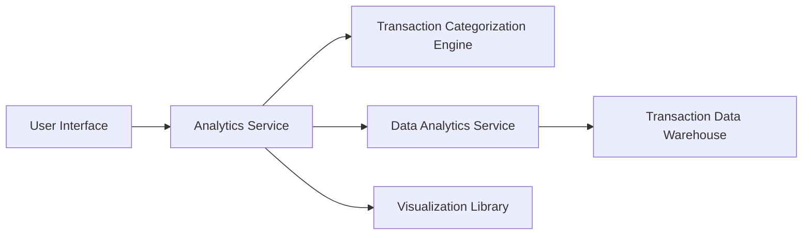

#### 1. High-Level Design

- **Summary:** This epic provides analytical capabilities through interactive visualizations and category-wise spending breakdowns across nine predefined categories (Food & Dining, Fuel, Shopping, Travel, Entertainment, Utilities, Healthcare, Education, Miscellaneous). Users can analyze monthly spending trends and gain actionable insights from transaction data.

- **Component Flow:**

- **Integration Points:**
  - **Upstream:** Transaction Data Warehouse (historical transaction data source)
  - **Downstream:** Transaction Categorization Engine, Data Analytics Service, Charting and Visualization Library, Spending Calculation Service

- **Key Assumptions:**
  - Transactions are pre-categorized into the nine predefined categories; no real-time categorization is required during visualization rendering.
  - Historical data for 12 months is readily available in the data warehouse with pre-aggregated spending summaries for performance.

- **NFR Highlights:** Visualizations must render within 3 seconds, support interactive filtering and drill-down, handle minimum 12 months of historical data, charts must be responsive and mobile-optimized, data accuracy of 99.9%.

- **Data Flow:** User requests spending analytics → Analytics Service queries Transaction Data Warehouse for historical data → Transaction Categorization Engine provides category mappings → Data Analytics Service performs aggregations and trend calculations → Spending Calculation Service computes category-wise totals → Visualization Library renders interactive charts → User interacts with filters and drill-down capabilities for deeper insights.

#### 2. Validation Report

- **Requirements Coverage:** The design comprehensively addresses all scope elements including monthly spend trend visualization, category-wise spending analysis, interactive charts and graphs, spending pattern identification, nine-category classification system, visual spending breakdowns, and trend comparison capabilities. All NFRs are architecturally supported: 3-second rendering through pre-aggregated data, interactive filtering via visualization library, 12-month historical data handling through data warehouse, responsive design through modern charting library, and 99.9% data accuracy through validated transaction data. All dependencies (transaction categorization engine, data analytics service, charting library, transaction data warehouse, spending calculation service) are explicitly integrated in the component architecture.