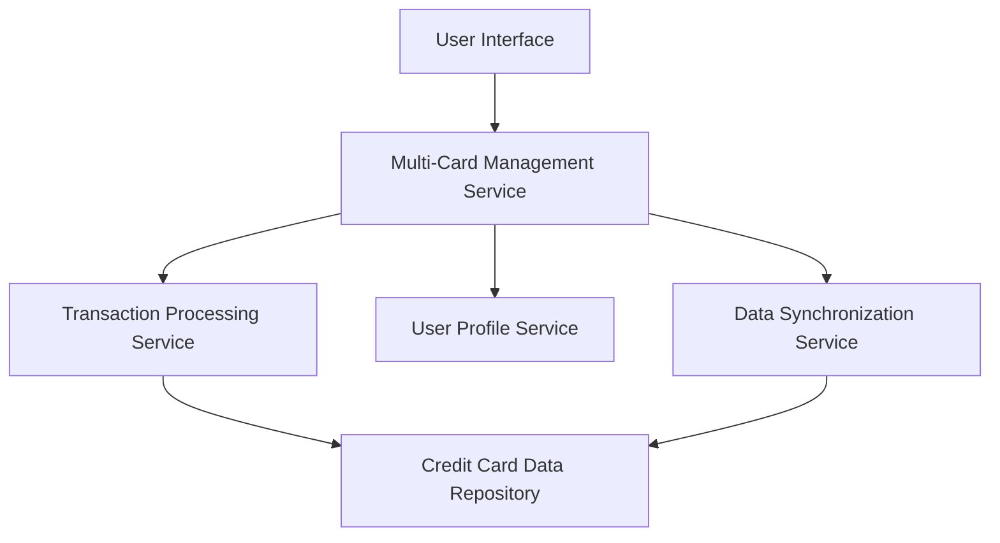

#### 1. High-Level Design

- **Summary:** This epic delivers a unified interface for managing multiple credit cards, enabling users to view card details, track transactions, analyze card-wise spending, and access comprehensive transaction history. The system consolidates multi-card data into a single view with drill-down capabilities for individual card analysis.

- **Component Flow:**

- **Integration Points:**
  - **Upstream:** User Profile Service (for card ownership validation)
  - **Downstream:** Credit Card Data Repository, Transaction Processing Service, Data Synchronization Service

- **Key Assumptions:**
  - Card data is synchronized in near real-time from external sources; transaction records are pre-validated for accuracy before display.
  - Card switching operations assume client-side caching for improved performance under 500ms response time.

- **NFR Highlights:** System must support minimum 10 credit cards per user with card switching response time under 500ms; transaction data must be accurate and consistent with support for concurrent card data updates.

- **Data Flow:** User requests card list → Multi-Card Management Service retrieves user's cards from User Profile Service → Card details and balances fetched from Credit Card Data Repository → Transaction Processing Service provides transaction history → Data Synchronization Service ensures real-time updates → Aggregated data presented to user with filtering and search capabilities.

#### 2. Validation Report

- **Requirements Coverage:** The design fully covers the epic's scope including multiple credit card display, card-wise spend analysis, transaction listing, card details view, credit limit and balance tracking, and transaction filtering/search. All stated NFRs (10 cards support, 500ms response time, concurrent updates) are architecturally supported through dedicated services and data synchronization mechanisms. Dependencies on credit card data repository, transaction processing service, user profile service, and data synchronization service are explicitly addressed in the component flow.