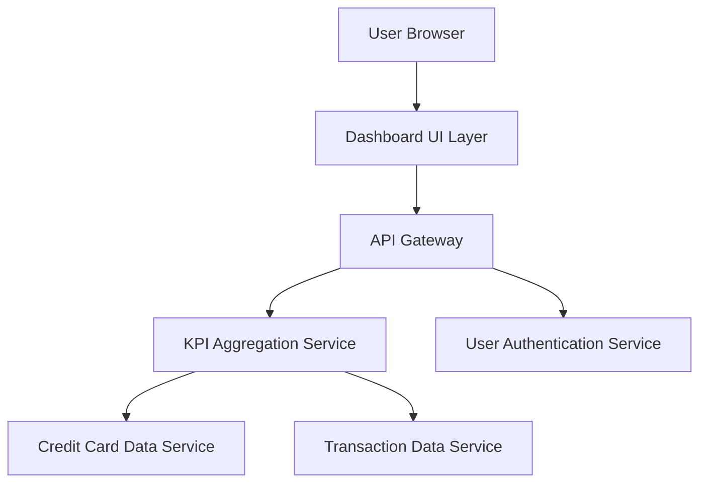

#### 1. High-Level Design

- **Summary:** This epic delivers a centralized dashboard interface displaying key performance indicators (KPIs) for credit card management, including monthly spend, total credit limit, available credit, and outstanding amounts. The dashboard provides users with immediate visibility into their overall credit card financial health across all cards in a responsive, consolidated view.

- **Component Flow:**

- **Integration Points:**
  - **Upstream:** User Authentication Service (for secure access and user identity verification)
  - **Downstream:** Credit Card Data Service (for retrieving card balances, limits, and card information), Transaction Data Service (for transaction data and spend calculations)

- **Key Assumptions:** 
  - KPI calculations are performed server-side with aggregated data refreshed at regular intervals (e.g., every 5 minutes) rather than real-time per transaction.
  - Dashboard data is user-specific and isolated per authenticated session with role-based access control.

- **NFR Highlights:** Dashboard must load within 2 seconds, support responsive design for mobile and desktop devices, handle concurrent users viewing dashboards simultaneously.

#### 2. Validation Report

- **Requirements Coverage:** The design fully covers the epic's stated scope by providing a UI layer for dashboard presentation, backend services for KPI aggregation (monthly spend, credit limits, available credit, outstanding amounts), integration with necessary data sources, and authentication. The responsive design requirement is addressed through the UI layer architecture. All specified KPIs are supported through the aggregation service interacting with credit card and transaction data services.