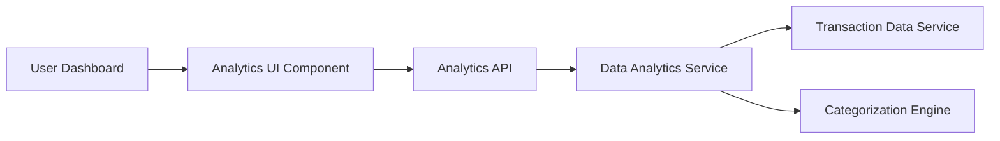

#### 1. High-Level Design

- **Summary:** This epic delivers interactive analytics and visualization capabilities enabling users to understand spending patterns through category-wise analysis and monthly spend trends. Users can explore spending across 9 predefined categories (Food & Dining, Fuel, Shopping, Travel, Entertainment, Utilities, Healthcare, Education, Miscellaneous) with visual representations through charts and graphs for data-driven financial decisions.

- **Component Flow:**

- **Integration Points:**
  - **Upstream:** Transaction Data Service (for raw transaction information and historical data)
  - **Downstream:** Categorization Engine (for transaction classification into predefined categories), Data Analytics Service (for trend computation, aggregation, and spending pattern analysis)

- **Key Assumptions:**
  - Transactions are automatically categorized by the categorization engine using rule-based or ML-based classification; manual recategorization by users is not in scope.
  - Historical data retention is set to 12 months as per NFR; older data is archived or aggregated for long-term storage.

- **NFR Highlights:** Analytics queries must return results within 1 second, visualizations must render smoothly on mobile and desktop, system must handle historical data for at least 12 months, support concurrent analytics requests from multiple users.

#### 2. Validation Report

- **Requirements Coverage:** The design comprehensively covers all stated requirements including category-wise spending visualization, monthly spend trend analysis, interactive charts/graphs, spending breakdown by categories, transaction categorization, spending pattern identification, and data filtering/drill-down capabilities. The architecture supports the stringent 1-second query response NFR through optimized data analytics service with pre-aggregated data and efficient indexing. Integration with all three specified dependencies (transaction data service, categorization engine, data analytics service) is clearly defined. The visualization layer is designed to render smoothly across devices as required.