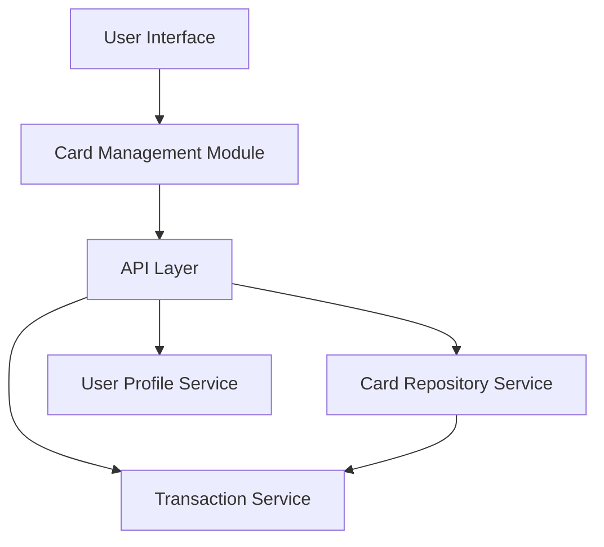

#### 1. High-Level Design

- **Summary:** This epic enables users to manage and monitor multiple credit cards from a unified interface, providing card listing, individual card details, card-wise spend analysis, and card-specific metrics. Users can view all cards with status, limits, and usage patterns to effectively manage their credit portfolio and understand spending distribution across different cards.

- **Component Flow:**

- **Integration Points:**
  - **Upstream:** User Profile Service (for card ownership validation and user-card associations)
  - **Downstream:** Credit Card Data Repository (for card information, status, limits), Transaction Service (for card-wise transaction data and spend analysis)

- **Key Assumptions:**
  - Card data is pre-loaded and cached for performance, with periodic synchronization from the card repository (assumed refresh cycle of 3 seconds as per NFR).
  - Card ownership is validated at the user profile service level before displaying card details.

- **NFR Highlights:** System must support display of unlimited number of cards per user, card data refresh must occur within 3 seconds, interface must maintain performance with up to 20 cards displayed simultaneously.

#### 2. Validation Report

- **Requirements Coverage:** The design addresses all core requirements including multiple card display, card listing interface, card-wise spend analysis, individual card details view, card selection/filtering, and card status indicators. The architecture supports the NFR of handling unlimited cards through pagination or virtualization techniques in the UI layer, while maintaining the 3-second refresh requirement through efficient caching and API design. Integration with all specified dependencies (card repository, transaction service, user profile service) is included.