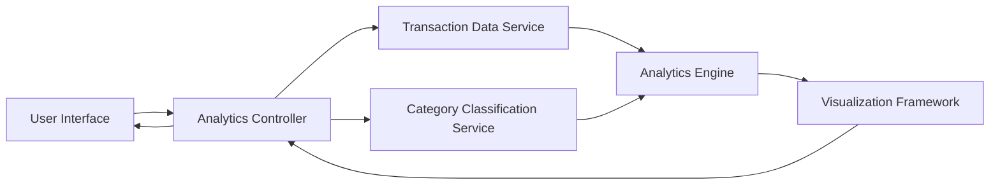

#### 1. High-Level Design

- **Summary:** This epic delivers comprehensive analytics and interactive visualizations to help users understand spending patterns across predefined categories (Food & Dining, Fuel, Shopping, Travel, Entertainment, Utilities, Healthcare, Education, Miscellaneous). It includes monthly spend trends and card-wise spend analysis for informed financial decision-making.

- **Component Flow:**

- **Integration Points:**
  - **Upstream:** Transaction data service (provides raw spending data for analysis)
  - **Upstream:** Category classification service (categorizes spending for breakdown analysis)
  - **Upstream:** Charting library or visualization framework (renders interactive charts)
  - **Downstream:** None explicitly mentioned; analytics is a presentation/insight layer

- **Key Assumptions:**
  - Aggregation and trend calculations are performed server-side or cached to ensure quick rendering.
  - Predefined categories are standardized and consistently applied across all transactions.

- **NFR Highlights:** Visualizations must render quickly and be interactive; analytics calculations must be accurate and consistent; charts responsive and accessible across all device types; efficient data aggregation for trend analysis.

#### 2. Validation Report

- **Requirements Coverage:** The design comprehensively covers all scope items including category-wise spending visualization, monthly spend trends, card-wise spend analysis, interactive charts, spending pattern identification, multi-category breakdown, and time-based trend analysis. The component flow demonstrates how the analytics controller coordinates transaction data retrieval, category classification, analytics computation, and visualization rendering. All NFRs regarding performance, accuracy, responsiveness, and efficient aggregation are reflected in the architecture.