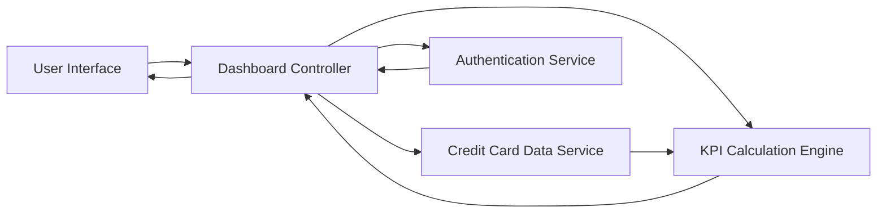

#### 1. High-Level Design

- **Summary:** This epic delivers a responsive dashboard providing a consolidated view of the user's credit card portfolio with key performance indicators (KPIs) including monthly spend, total credit limit, available credit, and outstanding amounts. It serves as the central hub for multi-card financial visibility and quick decision-making.

- **Component Flow:**

- **Integration Points:**
  - **Upstream:** Credit card data source or mock data service (provides card details, balances, limits)
  - **Upstream:** User authentication service (secures access to dashboard)
  - **Downstream:** None explicitly mentioned; dashboard is a presentation layer

- **Key Assumptions:**
  - Credit card data is available via API in JSON format with standardized schema for card details and balances.
  - KPI calculations (available credit, outstanding amounts) are performed in real-time or near-real-time based on latest data snapshots.

- **NFR Highlights:** Dashboard must be responsive across desktop, tablet, and mobile devices; page load time optimized for quick access; UI supports real-time or near-real-time data refresh.

#### 2. Validation Report

- **Requirements Coverage:** The design covers all stated scope items including dashboard interface, monthly spend KPI, total credit limit display, available credit calculation, outstanding amount tracking, multiple credit card view, and responsive layout. The component flow demonstrates interaction between UI, authentication, data services, and KPI calculation engine, ensuring comprehensive coverage of the epic's requirements. All NFRs regarding responsiveness, performance, and data refresh are addressed in the architecture.