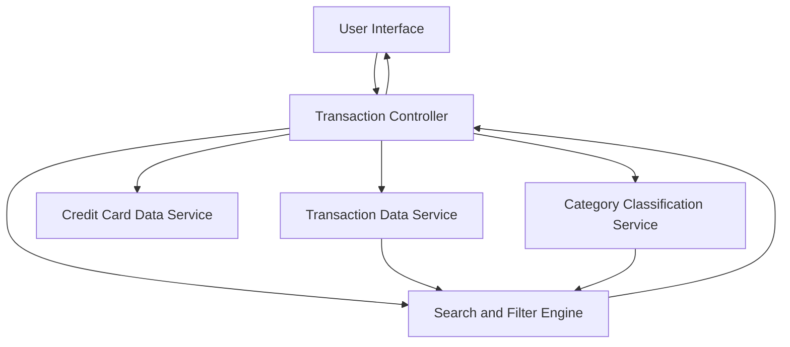

#### 1. High-Level Design

- **Summary:** This epic enables users to view, filter, and search detailed credit card transaction history across all cards. It provides transaction-level visibility with categorization, date range selection, and card-wise filtering to support spending pattern analysis and anomaly detection.

- **Component Flow:**

- **Integration Points:**
  - **Upstream:** Transaction data service or repository (provides raw transaction records)
  - **Upstream:** Credit card data service (enables card-wise filtering)
  - **Upstream:** Category classification service (categorizes transactions)
  - **Downstream:** Feeds data to analytics and insights components

- **Key Assumptions:**
  - Transactions are stored in a paginated data structure to handle large datasets efficiently.
  - Category classification is pre-computed or performed on-demand with acceptable latency.

- **NFR Highlights:** System must efficiently handle large transaction datasets; transaction queries return results within acceptable response times; data displayed in user-friendly, paginated format.

#### 2. Validation Report

- **Requirements Coverage:** The design fully addresses all scope elements including transaction list view, transaction details display, card-wise filtering, search functionality, categorization, and date range selection. The component flow illustrates how the transaction controller orchestrates interactions between data services, classification, and search/filter engines to deliver comprehensive transaction management. NFRs around performance, pagination, and large dataset handling are incorporated into the architecture design.