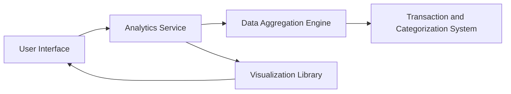

#### 1. High-Level Design

- **Summary:** This epic provides comprehensive analytics and visualization capabilities that transform transaction data into actionable insights. Features include Monthly Spend Trends, Card-wise Spend Analysis, and Category-wise Spending breakdown across nine predefined categories (Food & Dining, Fuel, Shopping, Travel, Entertainment, Utilities, Healthcare, Education, Miscellaneous). Interactive visualizations enable users to understand spending patterns and make informed financial decisions.

- **Component Flow:**

- **Integration Points:**
  - **Upstream:** Transaction Data and Categorization System (for source transaction data with categories)
  - **Downstream:** Data Aggregation and Analytics Processing Service (for computing trends and breakdowns)
  - **External:** Charting/Visualization Library (for rendering interactive charts)
  - **Dependencies:** Card and Transaction Management Systems (for consolidated data sources)

- **Key Assumptions:** 
  - Transaction categorization into the nine predefined categories is handled by an upstream system or service.
  - Analytics data is either computed in real-time for small datasets or pre-aggregated/cached for large volumes with scheduled refresh.

- **NFR Highlights:** Quick and smooth visualization rendering even with large datasets; interactive and responsive charts across all device types; accurate and consistent data aggregation; real-time or scheduled data refresh for up-to-date insights.

#### 2. Validation Report

- **Requirements Coverage:** The design comprehensively addresses all analytics requirements including Monthly Spend Trends, Card-wise Spend Analysis, and Category-wise Spending breakdown for all nine specified categories. The architecture separates concerns between data aggregation, analytics processing, and visualization rendering, ensuring scalability and maintainability. Performance NFRs are met through efficient aggregation strategies and optimized chart rendering. Integration dependencies are satisfied through connections to transaction, categorization, and card management systems. The use of a dedicated visualization library ensures interactive, responsive charts across devices as required.