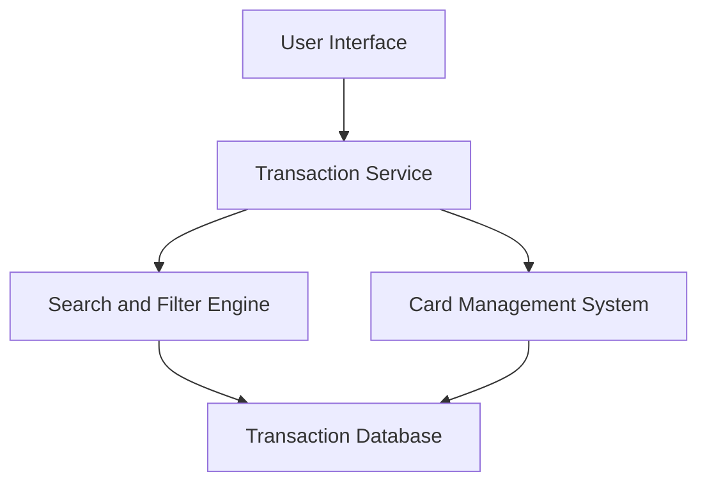

#### 1. High-Level Design

- **Summary:** This epic implements comprehensive transaction management functionality enabling users to view, search, and analyze credit card transactions across all cards. Users can access detailed transaction histories with merchant names, amounts, dates, and categories, supporting transparency, spending tracking, and financial decision-making.

- **Component Flow:**

- **Integration Points:**
  - **Upstream:** Card Management System (to associate transactions with specific cards)
  - **Downstream:** Transaction Data Repository/Database (for transaction records)
  - **Optional:** Categorization Service/Engine (for transaction classification by category)

- **Key Assumptions:** 
  - Transaction data is paginated or uses infinite scroll to handle large datasets efficiently.
  - Transaction categorization is either pre-computed in the database or provided by an external categorization service.

- **NFR Highlights:** Efficient handling of large transaction volumes; performant retrieval and display even with extensive histories; data accuracy and integrity maintained; responsive interface with pagination or infinite scroll support.

#### 2. Validation Report

- **Requirements Coverage:** The design covers all functional requirements including transaction listing, detail view, multi-card aggregation, search/filter capabilities, categorization display, and history access. The architecture supports efficient data retrieval through dedicated search and filter components. Performance requirements are addressed through pagination strategies and optimized database queries. Integration with the card management system ensures accurate transaction-to-card association as specified in dependencies.