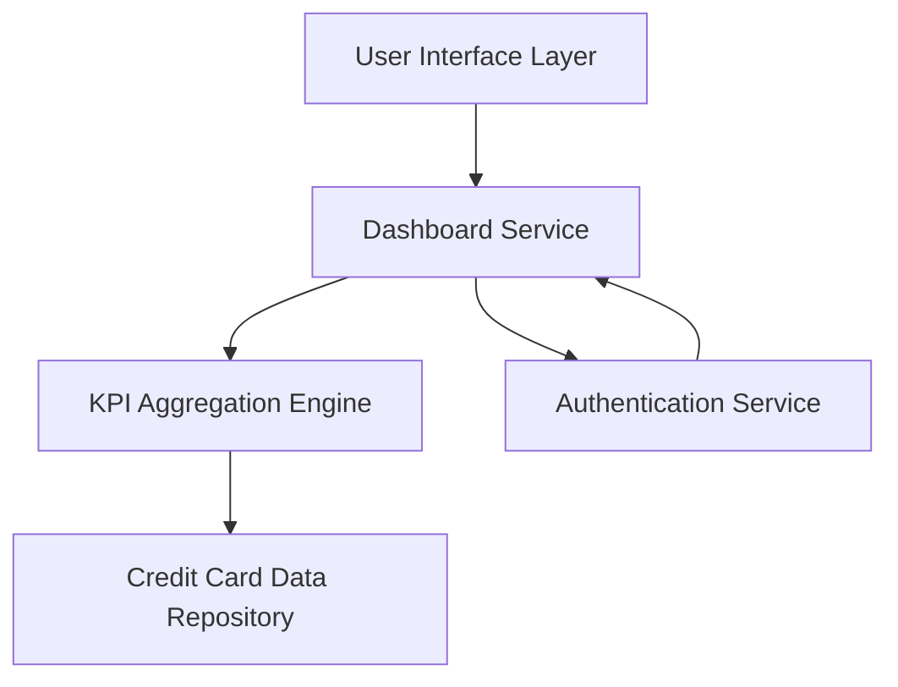

#### 1. High-Level Design

- **Summary:** This epic delivers a consolidated dashboard that displays all user-owned credit cards with key performance indicators (Monthly Spend, Total Credit Limit, Available Credit, Outstanding Amount). The solution provides a single, responsive interface for users to monitor their complete credit card portfolio and financial position across devices (mobile, tablet, desktop).

- **Component Flow:**

- **Integration Points:**
  - **Upstream:** User Authentication Service (for secure access)
  - **Downstream:** Credit Card Data Source/Repository (for card details and balances)
  - **Internal:** Data Aggregation Service (for KPI calculations across multiple cards)

- **Key Assumptions:** 
  - KPI data refresh frequency is near real-time or scheduled at regular intervals (e.g., every 5-15 minutes).
  - Credit card data is available in a structured format from a centralized repository with standardized schemas.

- **NFR Highlights:** Responsive design across all device types; dashboard load time within acceptable thresholds; real-time or near real-time data accuracy; modern and intuitive UI following current design standards.

#### 2. Validation Report

- **Requirements Coverage:** The design addresses all stated requirements including dashboard interface, multi-card display, KPI calculations (Monthly Spend, Total Credit Limit, Available Credit, Outstanding Amount), and responsive layout. The component flow ensures separation of concerns with dedicated services for authentication, data aggregation, and presentation. Integration points align with dependencies specified in the epic, ensuring secure access and accurate data retrieval from the credit card repository.