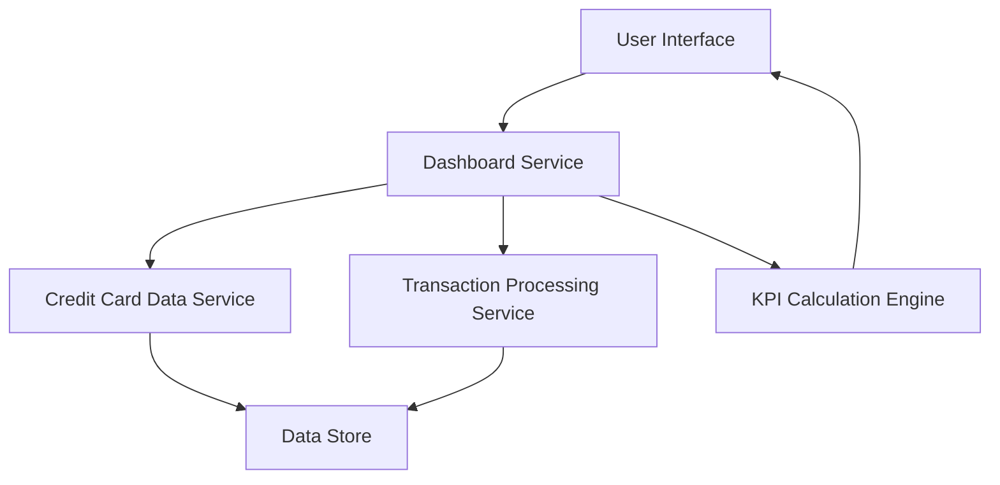

#### 1. High-Level Design

- **Summary:** This epic provides users with a consolidated dashboard displaying key performance indicators (KPIs) for their credit card portfolio. The dashboard presents critical metrics including monthly spend, total credit limit, available credit, and outstanding amount across all credit cards in a single, modern, responsive interface, giving users an at-a-glance view of their overall credit card financial health and spending status.

- **Component Flow:**

- **Integration Points:**
  - **Upstream:** Credit card data service (retrieves card information, balances, and credit limits)
  - **Upstream:** Transaction processing service (calculates monthly spend and outstanding amounts)

- **Key Assumptions:** 
  - Monthly spend is calculated based on current calendar month; historical month selection is not included in this epic scope.
  - Available credit is calculated as (Total Credit Limit - Outstanding Amount) using real-time data from the credit card data service.

- **NFR Highlights:** Dashboard must be responsive across desktop, tablet, and mobile devices; page load time must be optimized for quick access to financial data; data must be displayed with accuracy to 2 decimal places for currency values.

- **Data Flow:** User accesses dashboard via User Interface → Dashboard Service requests data from Credit Card Data Service (for credit limits and balances) and Transaction Processing Service (for monthly spend and outstanding amounts) → KPI Calculation Engine aggregates data across all user's credit cards to compute total credit limit, available credit, outstanding amount, and monthly spend → Calculated KPIs are formatted with 2 decimal precision → Dashboard Service returns formatted KPI data to User Interface → Responsive dashboard layout renders KPIs optimized for user's device type.

#### 2. Validation Report

- **Requirements Coverage:** The design fully addresses the epic's scope including dashboard KPIs display, monthly spend calculation and display, total credit limit aggregation, available credit calculation, outstanding amount tracking, and responsive dashboard layout. All NFRs are covered: responsive design across desktop/tablet/mobile devices through responsive UI components, optimized page load time through efficient KPI calculation engine and service architecture, and currency accuracy to 2 decimal places enforced in the KPI calculation engine. Dependencies on credit card data service and transaction processing service are properly integrated into the component flow and data retrieval patterns.