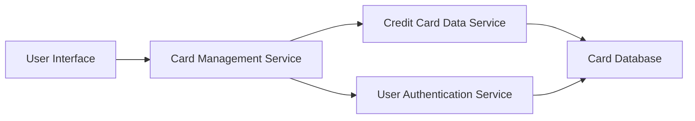

#### 1. High-Level Design

- **Summary:** This epic enables users to manage and view multiple credit cards within a consolidated dashboard interface. Users can view all their credit cards in a unified list, access individual card details, and perform card-wise spend analysis. The feature supports simultaneous monitoring of unlimited credit cards, providing comparison and tracking capabilities across the user's entire credit card portfolio.

- **Component Flow:**

- **Integration Points:**
  - **Upstream:** Credit card data service (retrieves multiple card information including limits and balances)
  - **Upstream:** User authentication service (associates cards with authenticated user accounts)

- **Key Assumptions:** 
  - Credit card data is stored and maintained in a centralized card database accessible via the credit card data service; real-time bank API integration is not required.
  - Card-wise spend analysis uses transaction data already associated with individual card identifiers in the system.

- **NFR Highlights:** System must support display of unlimited number of credit cards per user; card data retrieval must be efficient to prevent performance degradation with multiple cards; UI must maintain usability with large numbers of cards.

- **Data Flow:** User authenticates via User Authentication Service → User Interface requests card list from Card Management Service → Card Management Service retrieves all cards associated with the authenticated user from Credit Card Data Service → Credit Card Data Service queries Card Database for card details (limits, balances, outstanding amounts) → Card data is returned to UI for display in consolidated view → User selects individual card → Detailed card information and card-wise spend analysis are retrieved and displayed.

#### 2. Validation Report

- **Requirements Coverage:** The design comprehensively covers the epic's scope including multiple credit card display, card-wise spend analysis, individual card detail views, card listing and selection, credit limit display per card, and outstanding balance per card. The architecture supports the NFR of unlimited cards per user through efficient data retrieval patterns and scalable service design. Performance considerations for multiple cards are addressed through the dedicated Card Management Service and optimized queries to the Credit Card Data Service. Integration dependencies with credit card data service and user authentication service are fully incorporated into the component flow.