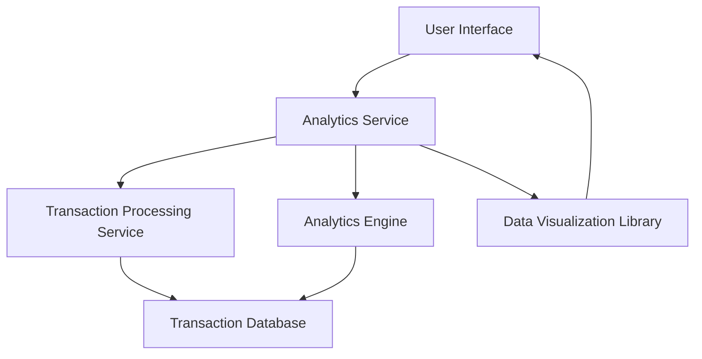

#### 1. High-Level Design

- **Summary:** This epic delivers comprehensive spending analytics and transaction insights through interactive visualizations. Users can analyze spending patterns through nine predefined categories (Food & Dining, Fuel, Shopping, Travel, Entertainment, Utilities, Healthcare, Education, Miscellaneous), view monthly spend trends, and access transaction history to understand their spending behavior and identify financial optimization opportunities.

- **Component Flow:**

- **Integration Points:**
  - **Upstream:** Transaction processing service (provides categorized transaction data)
  - **Upstream:** Analytics engine (calculates trends, patterns, and aggregations)
  - **Internal:** Data visualization library (renders interactive charts and graphs)

- **Key Assumptions:** 
  - Transactions are pre-categorized by the transaction processing service into the nine defined categories; manual recategorization is not required.
  - Monthly trends are calculated based on calendar months; fiscal month or custom period analysis is not supported.

- **NFR Highlights:** Visualizations must render within 2 seconds; charts must be interactive and responsive across all device types; system must handle transaction data aggregation efficiently for reporting.

- **Data Flow:** User requests spending analytics via the UI → Analytics Service retrieves transaction data from Transaction Processing Service → Analytics Engine aggregates and calculates category-wise spending, monthly trends, and patterns from Transaction Database → Processed data is formatted and passed to Data Visualization Library → Interactive charts and transaction history are rendered in the UI for user consumption.

#### 2. Validation Report

- **Requirements Coverage:** The design fully covers the epic's stated scope including category-wise spending visualization (9 categories), monthly spend trends analysis, transaction history display, interactive charts and graphs, and spending pattern identification. All NFRs regarding rendering performance (2 seconds), responsiveness across devices, and efficient data aggregation are addressed through the component architecture with dedicated analytics engine and visualization library. The integration with transaction processing service and analytics engine satisfies the stated dependencies.