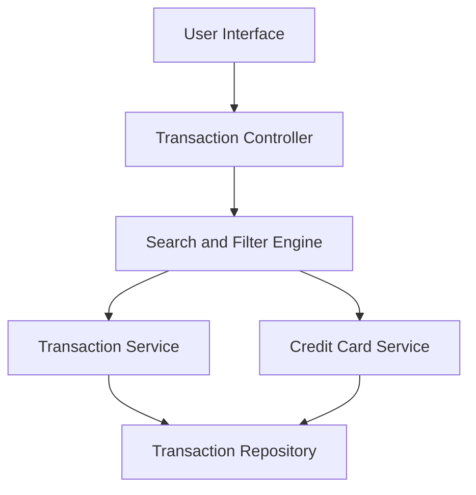

#### 1. High-Level Design

- **Summary:** This epic provides comprehensive transaction management capabilities enabling users to view, search, and filter credit card transactions across all their cards. Users can access detailed transaction history with an intuitive, responsive interface that works seamlessly across all devices. The solution aggregates transactions from multiple cards and provides robust search and filter capabilities to help users understand spending behavior, verify charges, and maintain financial records.

- **Component Flow:**

- **Integration Points:**
  - **Upstream:** Transaction data service or repository for retrieving historical transaction records
  - **Upstream:** Credit Card service for associating transactions with specific cards and validating card ownership
  - **Internal:** Search and Filter Engine processes user queries against transaction data

- **Key Assumptions:**
  - Transaction data includes standard fields (date, amount, merchant, category, card ID) in a consistent format across all cards
  - Search and filter operations support common criteria such as date range, amount range, merchant name, and category without requiring custom query language

- **NFR Highlights:** System must handle transaction history efficiently; Responsive design for transaction views across all device types; Fast transaction retrieval and display performance

#### 2. Validation Report

- **Requirements Coverage:** The design comprehensively addresses all scope items including Transaction listing, Transaction details view, Multi-card transaction aggregation, Transaction search and filter capabilities, and Responsive transaction interface. The architecture supports efficient transaction retrieval through the Transaction Service and Repository pattern. The Search and Filter Engine component ensures robust query capabilities. NFRs for efficiency, responsiveness, and performance are supported through the service layer design and repository pattern for optimized data access.