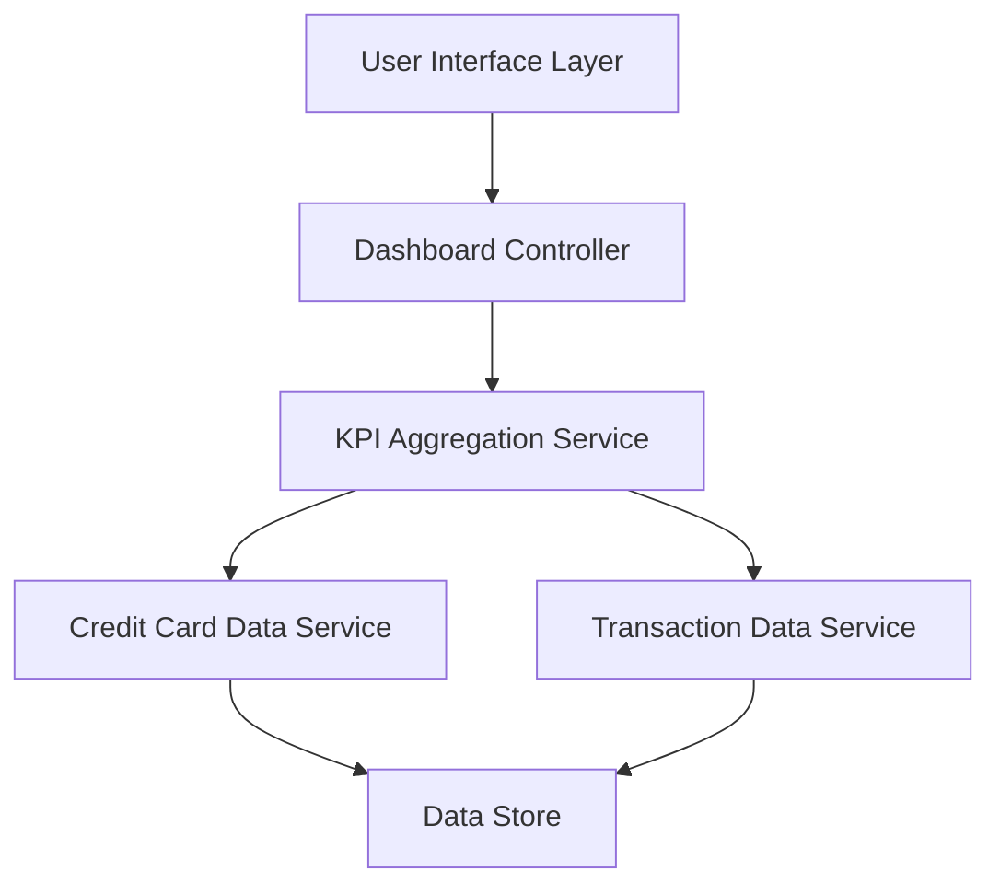

#### 1. High-Level Design

- **Summary:** This epic delivers a consolidated dashboard that displays key performance indicators (KPIs) for the user's credit card portfolio. The dashboard aggregates and presents critical financial metrics including monthly spend, total credit limit, available credit, and outstanding amounts across all credit cards. The solution provides real-time visibility into the user's overall credit position through a modern, responsive interface accessible across desktop, tablet, and mobile devices.

- **Component Flow:**

- **Integration Points:**
  - **Upstream:** Credit Card data source or service for retrieving card details, balances, and credit limits
  - **Upstream:** Transaction data service for calculating monthly spend and outstanding amounts
  - **Internal:** KPI Aggregation Service consolidates data from multiple sources for dashboard display

- **Key Assumptions:**
  - Real-time data refresh implies data synchronization occurs at regular intervals (e.g., every 5-15 minutes) or on-demand user refresh action
  - Credit card data includes all necessary fields (card number, limit, balance, status) in a standardized format from the upstream service

- **NFR Highlights:** Dashboard must be responsive across desktop, tablet, and mobile devices; Real-time data refresh for KPI metrics; Support for managing multiple credit cards simultaneously

#### 2. Validation Report

- **Requirements Coverage:** The design fully covers the epic's stated scope including Dashboard KPIs display, Monthly Spend tracking, Total Credit Limit aggregation, Available Credit calculation, Outstanding Amount tracking, Multiple Credit Cards view, and Responsive layout design. The component architecture supports all required integrations with Credit Card and Transaction data services. The NFRs for responsiveness, real-time refresh, and multi-card support are addressed through the UI layer and aggregation service design.