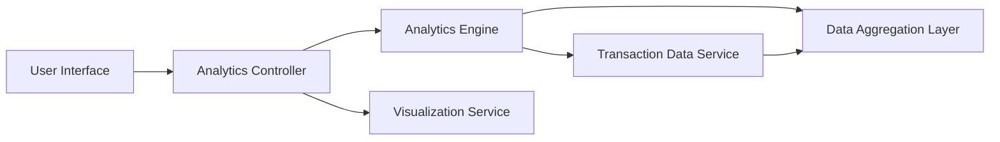

#### 1. High-Level Design

- **Summary:** This epic delivers interactive analytics and visualization capabilities that provide users with deep insights into their spending patterns. The solution analyzes expenses through category-wise breakdowns across 9 predefined categories (Food & Dining, Fuel, Shopping, Travel, Entertainment, Utilities, Healthcare, Education, and Miscellaneous), monthly spend trend analysis, and card-wise spend analysis. Users receive visual representations of their financial behavior through interactive charts and graphs, helping them identify spending patterns, optimize budget allocation, and make data-driven financial decisions.

- **Component Flow:**

- **Integration Points:**
  - **Upstream:** Transaction data service for aggregating spending data across all cards and time periods
  - **Internal:** Analytics engine or service for calculating trends, category breakdowns, and card-wise analysis
  - **Internal:** Visualization library for rendering interactive charts (e.g., bar charts, pie charts, line graphs)

- **Key Assumptions:**
  - Transactions are pre-categorized or the system includes a categorization engine that maps merchants/transaction descriptions to the 9 predefined spending categories
  - Monthly trend analysis covers a default period (e.g., last 12 months) with user ability to adjust the time range

- **NFR Highlights:** Interactive visualizations must be responsive and performant; Analytics calculations must be accurate and timely; Charts must render efficiently across all device types

#### 2. Validation Report

- **Requirements Coverage:** The design fully addresses all scope elements including Category-wise Spending visualization, Monthly Spend Trends analysis, Card-wise Spend Analysis, Interactive charts and graphs, and Spending pattern identification across 9 predefined categories. The Analytics Engine component handles complex calculations for trends and breakdowns. The Visualization Service ensures interactive, responsive chart rendering. The Data Aggregation Layer optimizes performance for analytics queries. All NFRs for responsiveness, performance, accuracy, and cross-device compatibility are supported through the layered architecture with dedicated analytics and visualization components.