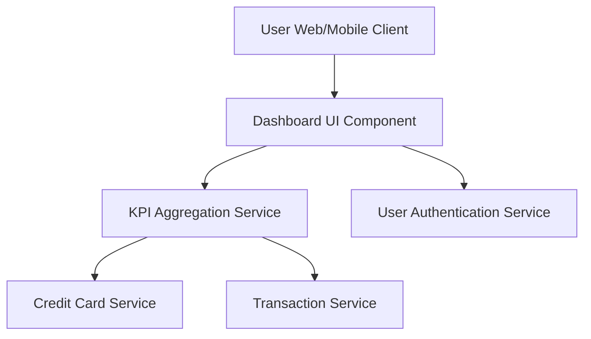

#### 1. High-Level Design

- **Summary:** This epic delivers a unified dashboard interface that consolidates key performance indicators (KPIs) across all user credit cards. The core requirement is to provide real-time visibility into monthly spend, total credit limit, available credit, and outstanding amounts through a responsive, multi-device interface. The scope includes data aggregation from multiple cards and real-time metric calculation.

- **Component Flow:**

- **Integration Points:**
  - **Upstream:** User Authentication Service (for secure access and user identity)
  - **Downstream:** Credit Card Service (for card data aggregation), Transaction Service (for spending calculations and transaction data)

- **Key Assumptions:**
  - KPI data is assumed to be aggregated on-demand from underlying services; no pre-computed materialized views are assumed unless performance requires it.
  - Real-time refresh implies data is fetched with each dashboard load or at regular polling intervals (e.g., every 30-60 seconds).

- **NFR Highlights:** Dashboard must be responsive across desktop, tablet, and mobile devices; KPI data must refresh in real-time; System must support concurrent viewing by multiple users.

- **Data Flow:** User authenticates via User Authentication Service → Dashboard UI requests KPI data → KPI Aggregation Service fetches card details from Credit Card Service and spending data from Transaction Service → Service calculates monthly spend, total credit limit, available credit, and outstanding amounts → Aggregated KPIs returned to Dashboard UI → User views consolidated metrics in real-time.

#### 2. Validation Report

- **Requirements Coverage:** The design fully covers the epic's stated scope including monthly spend display, total credit limit calculation, available credit tracking, outstanding amount monitoring, responsive dashboard layout, and consolidated multi-card view. All NFRs (responsiveness, real-time refresh, concurrent user support) are addressed through the component architecture and service integration points.