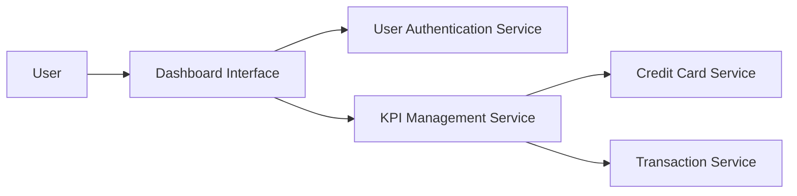

#### 1. High-Level Design

- **Summary:** This epic delivers a modern, responsive dashboard interface displaying consolidated KPIs (monthly spend, total credit limit, available credit, outstanding amounts) across all credit cards. The solution provides real-time visibility into overall credit card financial health and spending behavior from a single unified view.

- **Component Flow:**

- **Integration Points:** 
  - **Upstream:** User Authentication Service (for secure access), Credit Card Service (for card data aggregation), Transaction Service (for spending calculations)
  - **Downstream:** None specified

- **Key Assumptions:** 
  - Credit Card Service provides aggregated card data across all user's cards
  - Transaction Service maintains up-to-date spending totals for real-time KPI display

- **NFR Highlights:** Dashboard must be responsive across desktop, tablet, and mobile devices; KPI data must refresh in real-time; System must support concurrent viewing by multiple users

- **Data Flow:** User authenticates via User Authentication Service → User accesses dashboard → KPI Management Service requests aggregated card data from Credit Card Service and spending data from Transaction Service → Service calculates consolidated KPIs (monthly spend, total credit limit, available credit, outstanding amounts) → Dashboard Interface displays real-time KPIs in responsive layout → System supports concurrent access by multiple users

#### 2. Validation Report

- **Requirements Coverage:** The design addresses all scope elements including monthly spend display, total credit limit calculation, available credit tracking, outstanding amount monitoring, responsive dashboard layout, and consolidated multi-card view. All three dependencies (Credit Card Service, Transaction Service, User Authentication Service) are integrated. NFRs for responsive design across all device types, real-time KPI refresh, and concurrent user support are incorporated in the architecture.