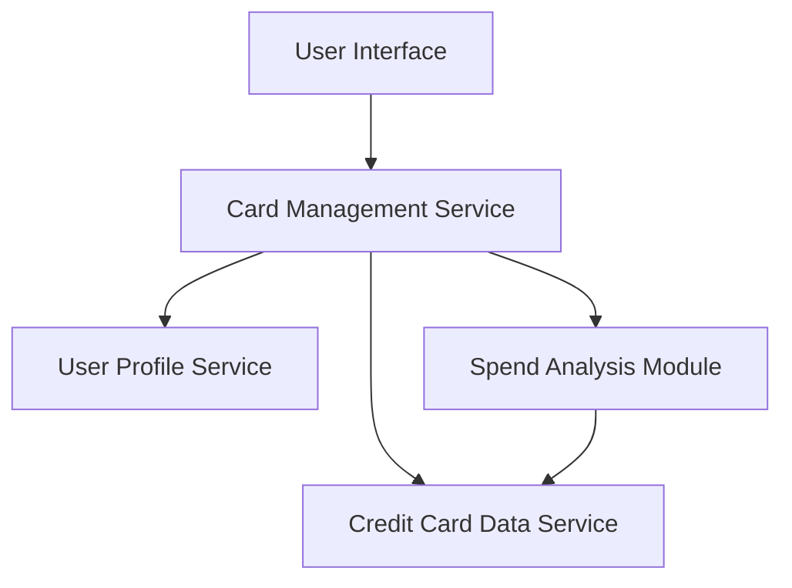

#### 1. High-Level Design

- **Summary:** This epic enables users to manage and monitor multiple credit cards within a single interface, providing individual card details, card-wise spend analysis, and card-specific metrics (credit limits, outstanding balances). The solution helps users make informed decisions about which card to use for specific purchases based on card performance and usage patterns.

- **Component Flow:**

- **Integration Points:** 
  - **Upstream:** User Profile Service (for card ownership mapping)
  - **Downstream:** Credit Card Data Service (for card information storage and retrieval)

- **Key Assumptions:** 
  - User-card associations are maintained and updated by the User Profile Service
  - Card data includes all necessary attributes (limits, balances, transaction history) for spend analysis

- **NFR Highlights:** System must support management of at least 10 credit cards per user; Card data retrieval must complete within 2 seconds; Data must be securely stored and transmitted

- **Data Flow:** User accesses card management interface → Card Management Service retrieves user's card associations from User Profile Service → Credit Card Data Service provides individual card details (credit limits, outstanding balances) → Spend Analysis Module calculates card-wise spend metrics → Interface displays all cards with individual details and performance metrics within 2 seconds → User views card-specific information to make informed usage decisions

#### 2. Validation Report

- **Requirements Coverage:** The design covers all scope items including multiple credit card display, card-wise spend analysis, individual card details view, card-specific credit limit tracking, and card-specific outstanding balance monitoring. Both dependencies (User Profile Service and Credit Card Data Service) are integrated. NFRs for supporting at least 10 cards per user, 2-second data retrieval, and secure data storage/transmission are addressed in the architecture.