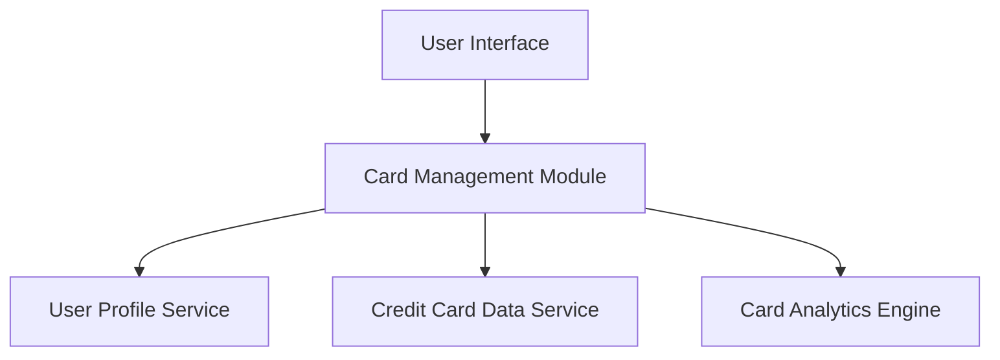

#### 1. High-Level Design

- **Summary:** This epic enables users to manage and monitor multiple credit cards (up to 10 per user) within a single interface. The core requirement is to provide individual card details, card-wise spend analysis, and card-specific metrics (credit limits, outstanding balances) to help users optimize card usage. The scope includes displaying all user cards and enabling detailed drill-down into each card's performance.

- **Component Flow:**

- **Integration Points:**
  - **Upstream:** User Profile Service (for card ownership mapping and user-card associations)
  - **Downstream:** Credit Card Data Service (for card information storage, retrieval, and card-specific metrics)

- **Key Assumptions:**
  - Card ownership mapping is maintained in User Profile Service; card details are stored and retrieved from Credit Card Data Service.
  - Card-wise spend analysis assumes transaction data is tagged with card identifiers for filtering and aggregation.

- **NFR Highlights:** System must support management of at least 10 credit cards per user; Card data retrieval must complete within 2 seconds; Data must be securely stored and transmitted.

- **Data Flow:** User logs in → Card Management Module queries User Profile Service to retrieve list of user's cards → Module fetches detailed card information from Credit Card Data Service → Card Analytics Engine processes card-wise spending data → User views all cards with individual metrics (credit limit, outstanding balance, spend analysis) → User can drill down into specific card details for deeper analysis.

#### 2. Validation Report

- **Requirements Coverage:** The design comprehensively covers the epic's scope including multiple credit card display, card-wise spend analysis, individual card details view, card-specific credit limit tracking, and card-specific outstanding balance monitoring. All NFRs are addressed: support for 10+ cards per user, 2-second retrieval time (via efficient service calls), and secure data handling (implied through service architecture and authentication).