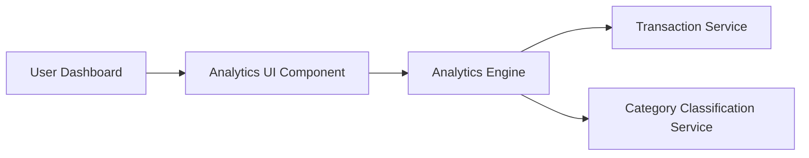

#### 1. High-Level Design

- **Summary:** This epic provides interactive visualizations and analytics to help users understand spending patterns across nine predefined categories (Food & Dining, Fuel, Shopping, Travel, Entertainment, Utilities, Healthcare, Education, Miscellaneous) and time periods. The core requirement is to deliver category-wise spending breakdowns and monthly trend analysis through interactive, responsive charts that support up to 12 months of transaction history.

- **Component Flow:**

- **Integration Points:**
  - **Upstream:** Transaction Service (for raw transaction data), Category Classification Service (for expense categorization into predefined categories)
  - **Downstream:** Analytics Engine (for data aggregation, trend calculations, and time-based analysis)

- **Key Assumptions:**
  - Transactions are pre-classified into the nine predefined categories by the Category Classification Service; no manual categorization is required.
  - Monthly trend analysis assumes data is aggregated by month; time-based comparisons use calendar months as the default unit.

- **NFR Highlights:** Visualizations must load within 3 seconds; Analytics must support data aggregation for up to 12 months of transaction history; Charts must be interactive and responsive across all device types.

- **Data Flow:** User accesses Analytics dashboard → Analytics UI Component requests spending insights from Analytics Engine → Engine retrieves transaction data from Transaction Service → Transactions are categorized by Category Classification Service → Engine aggregates data by category and time period (monthly) → Calculated insights and trends returned to UI → User interacts with visualizations (category-wise spending, monthly trends) across responsive charts.

#### 2. Validation Report

- **Requirements Coverage:** The design fully addresses the epic's scope including category-wise spending visualization, monthly spend trends, interactive charts and graphs, spending pattern analysis across nine predefined categories, and time-based spending comparisons. All NFRs are covered: 3-second load time (via efficient data aggregation), 12-month history support (through Analytics Engine), and interactive responsive charts (via Analytics UI Component).