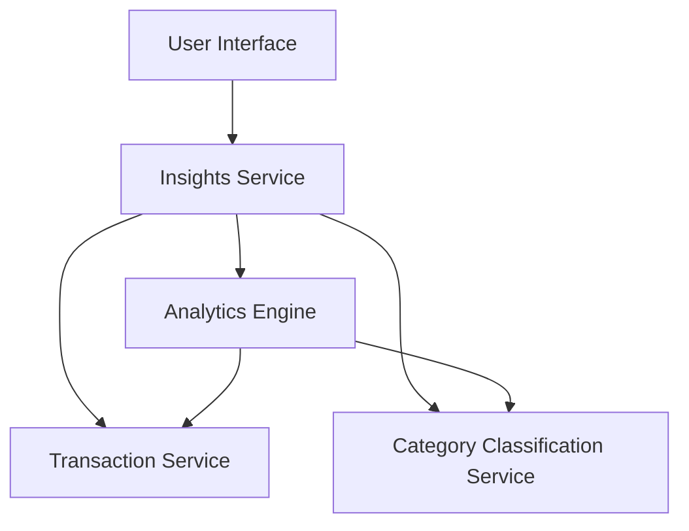

#### 1. High-Level Design

- **Summary:** This epic provides interactive visualizations and analytics to help users understand spending patterns across categories (Food & Dining, Fuel, Shopping, Travel, Entertainment, Utilities, Healthcare, Education, Miscellaneous) and time periods. The solution includes category-wise spending breakdowns and monthly spend trend analysis for data-driven financial decisions.

- **Component Flow:**

- **Integration Points:** 
  - **Upstream:** Transaction Service (for transaction data), Category Classification Service (for expense categorization)
  - **Downstream:** Analytics Engine (for data aggregation and trend calculations)

- **Key Assumptions:** 
  - Transactions are pre-classified into the nine predefined categories by the Category Classification Service
  - Monthly aggregation is performed on a rolling 12-month window

- **NFR Highlights:** Visualizations must load within 3 seconds; Analytics must support data aggregation for up to 12 months of transaction history; Charts must be interactive and responsive across all device types

- **Data Flow:** User accesses insights interface → Insights Service retrieves transaction data from Transaction Service → Category Classification Service provides category mappings → Analytics Engine aggregates spending data by category and month for up to 12 months → Interactive, responsive charts and graphs are rendered on user interface within 3 seconds → User interacts with visualizations for time-based spending comparisons

#### 2. Validation Report

- **Requirements Coverage:** The design addresses all scope elements including category-wise spending visualization, monthly spend trends, interactive charts and graphs, spending pattern analysis across nine predefined categories, and time-based spending comparisons. All three dependencies (Transaction Service, Category Classification Service, Analytics Engine) are incorporated. NFRs for visualization load time (3 seconds), 12-month historical data support, and interactive/responsive charts across all device types are met in the architecture.