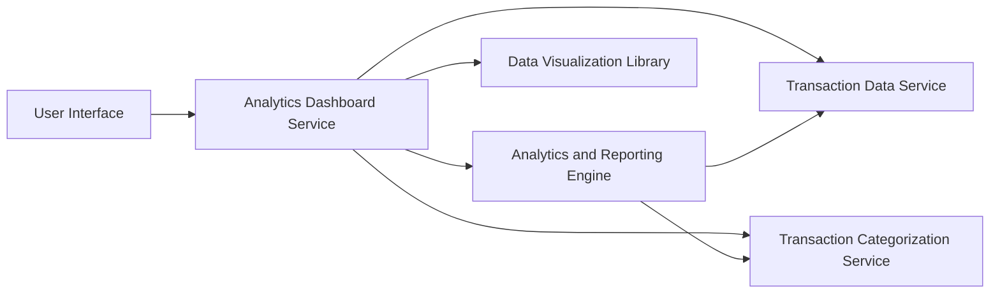

#### 1. High-Level Design

- **Summary:** This epic delivers comprehensive spending analytics through interactive visualizations, breaking down expenditures by category (9 predefined categories: Food & Dining, Fuel, Shopping, Travel, Entertainment, Utilities, Healthcare, Education, Miscellaneous) and by card. The solution includes monthly spend trend analysis and card-wise spend breakdowns to help users identify spending habits.

- **Component Flow:**

- **Integration Points:** 
  - **Upstream:** Transaction Data Service (for raw transaction data), Transaction Categorization Service (for category classification)
  - **Downstream:** Analytics and Reporting Engine (for data processing and aggregation), Data Visualization Library (for rendering charts)

- **Key Assumptions:** 
  - Transactions are automatically categorized by the Transaction Categorization Service with 95% accuracy
  - Historical transaction data is retained for at least 12 months for trend analysis

- **NFR Highlights:** Visualizations must render within 3 seconds; System must support filtering and drill-down capabilities; Analytics must process and categorize transactions with 95% accuracy; Support historical data for at least 12 months

- **Data Flow:** User accesses analytics dashboard → Analytics Dashboard Service requests transaction data from Transaction Data Service → Transaction Categorization Service classifies transactions into 9 categories → Analytics and Reporting Engine aggregates data by category, card, and time period → Data Visualization Library renders interactive charts (category-wise spending, monthly trends, card-wise breakdowns) → User interacts with visualizations using filtering and drill-down capabilities

#### 2. Validation Report

- **Requirements Coverage:** The design comprehensively covers all scope items including category-wise spending visualization, monthly spend trend charts, card-wise spend analysis, interactive analytics dashboard, nine spending categories tracking, transaction categorization, and spending pattern reports. All four dependencies (Transaction Data Service, Analytics and Reporting Engine, Data Visualization Library, Transaction Categorization Service) are integrated. NFRs for rendering time (3 seconds), filtering/drill-down support, categorization accuracy (95%), and historical data retention (12 months) are addressed in the architecture.