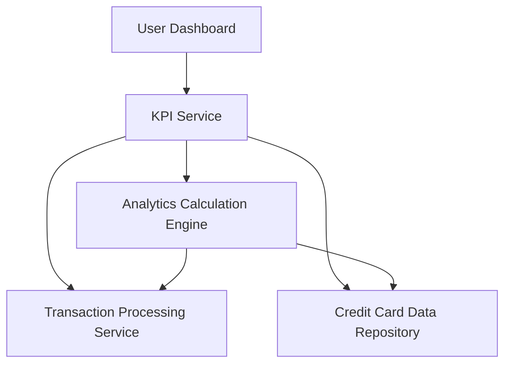

#### 1. High-Level Design

- **Summary:** This epic provides users with critical financial KPIs (monthly spend, total credit limit, available credit, outstanding amounts) displayed in an easily digestible format. The solution enables real-time visibility into credit card spending behavior and financial health to support informed decision-making.

- **Component Flow:**

- **Integration Points:** 
  - **Upstream:** Transaction Processing Service (for transaction data), Credit Card Data Repository (for card limits and balances)
  - **Downstream:** Analytics Calculation Engine (for KPI computation)

- **Key Assumptions:** 
  - Transaction data is continuously ingested and available for near real-time processing
  - KPI calculations follow standard financial formulas (e.g., available credit = total limit - outstanding amount)

- **NFR Highlights:** KPI calculations accurate to 2 decimal places; KPI refresh rate near real-time with maximum 5-minute delay; System must handle concurrent KPI requests from multiple users

- **Data Flow:** User accesses dashboard → KPI Service requests data from Transaction Processing Service and Credit Card Data Repository → Analytics Calculation Engine computes monthly spend, total credit limit, available credit, and outstanding amounts → Calculated KPIs are returned to KPI Service → KPIs are displayed on user dashboard with near real-time updates (max 5-minute delay)

#### 2. Validation Report

- **Requirements Coverage:** The design addresses all scope elements including monthly spend KPI display, total credit limit KPI, available credit KPI, outstanding amount KPI, KPI visualization components, and real-time KPI updates. The architecture incorporates the three specified dependencies (Transaction Processing Service, Credit Card Data Repository, Analytics Calculation Engine) and meets NFRs for calculation accuracy (2 decimal places), refresh rate (5-minute max delay), and concurrent user support.