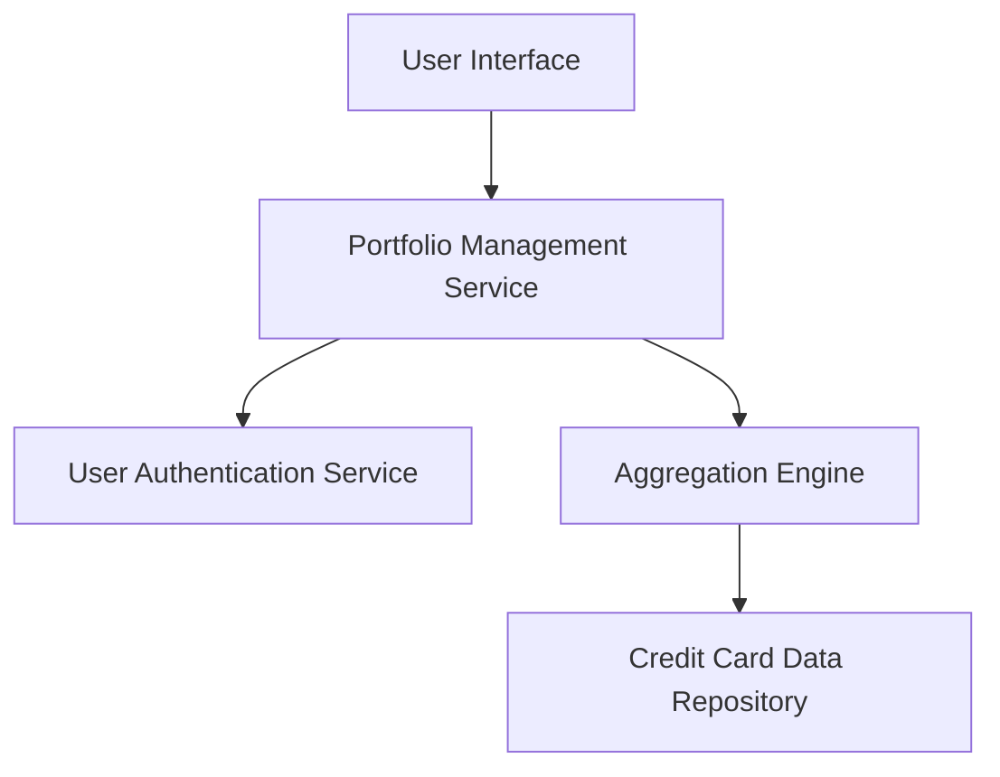

#### 1. High-Level Design

- **Summary:** This epic delivers a consolidated interface for users to view and manage multiple credit cards, displaying key financial metrics (total credit limits, available credit, outstanding amounts) across the entire portfolio. The solution provides a unified dashboard that eliminates the need for users to access multiple banking platforms.

- **Component Flow:**

- **Integration Points:** 
  - **Upstream:** User Authentication Service (for secure user access)
  - **Downstream:** Credit Card Data Repository (for retrieving card data)

- **Key Assumptions:** 
  - Credit card data is pre-populated in the repository and updated periodically by external processes
  - User-card ownership mapping is maintained by the authentication service

- **NFR Highlights:** Dashboard load time must be under 2 seconds; Responsive design across desktop, tablet, and mobile devices; Support for at least 10 credit cards per user

- **Data Flow:** User authenticates → Portfolio Management Service fetches user's credit card list → Aggregation Engine retrieves individual card data from repository → System calculates total credit limits, available credit, and outstanding amounts → Consolidated metrics are displayed on the responsive dashboard interface

#### 2. Validation Report

- **Requirements Coverage:** The design covers all stated scope items including multiple credit card display, credit card overview interface, total credit limit aggregation, available credit calculation, outstanding amount tracking, and responsive dashboard layout. The architecture addresses the NFRs for responsive design, load time, and card capacity. Integration with User Authentication Service and Credit Card Data Repository is incorporated as specified in dependencies.