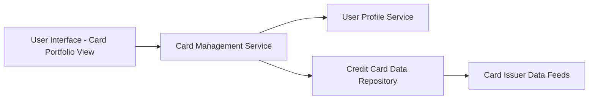

#### 1. High-Level Design

- **Summary:** This epic enables users to view and manage multiple credit cards from a single consolidated interface. Users can view all cards with relevant details, switch between cards, and access card-wise spending analysis including credit limit, available balance, and outstanding amounts for efficient multi-card management.

- **Component Flow:**

- **Integration Points:**
  - **Upstream:** User profile service for card associations; Card issuer data feeds for card details
  - **Downstream:** Credit card data repository for persistent storage and retrieval

- **Key Assumptions:**
  - Card details are synchronized periodically from card issuer data feeds (frequency not specified, assume daily or real-time webhook updates).
  - Card switching functionality uses client-side state management with server-side data fetching to meet sub-500ms response time.

- **NFR Highlights:** Support minimum 10 credit cards per user; card switching response time under 500ms; secure storage and display of card information; data encryption for sensitive card details.

#### 2. Validation Report

- **Requirements Coverage:** The design addresses all scope items including multiple credit card display, card selection and switching, card-wise spend analysis, individual card credit limit display, card-specific outstanding balance tracking, and card details view. The architecture supports the NFR of 10+ cards per user through scalable data repository design. The sub-500ms switching requirement is achievable through optimized data fetching and client-side caching. Security requirements (encryption, secure storage) are addressed at the data repository and service layers.