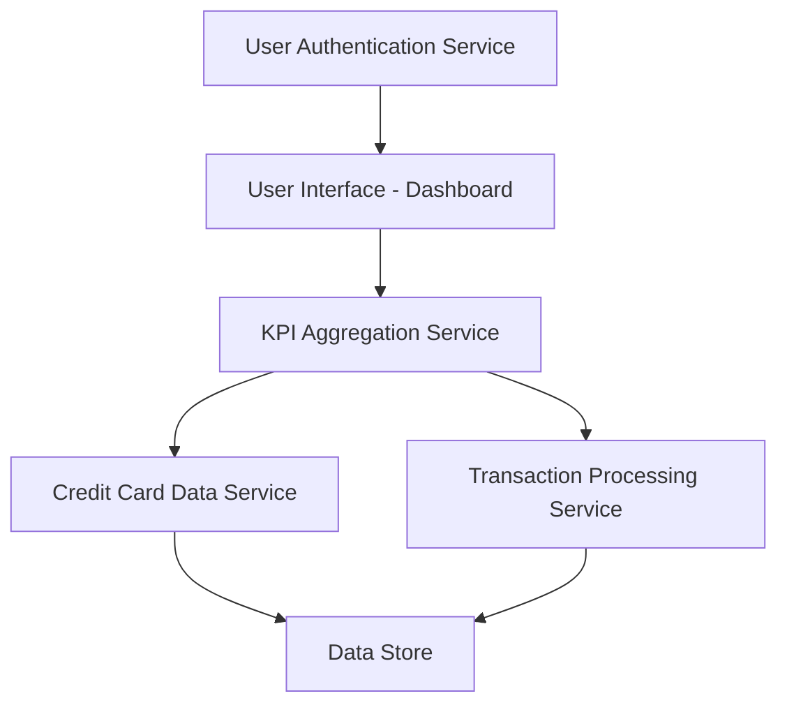

#### 1. High-Level Design

- **Summary:** This epic delivers a responsive dashboard that consolidates credit card portfolio metrics through key performance indicators (KPIs). Users can monitor monthly spend, total credit limit, available credit, and outstanding amounts in real-time, serving as the central hub for credit card financial insights.

- **Component Flow:**

- **Integration Points:**
  - **Upstream:** User authentication service for secure access
  - **Downstream:** Credit card data service for retrieving card information; Transaction processing service for spending calculations

- **Key Assumptions:**
  - Real-time data refresh implies periodic polling or event-driven updates (frequency not specified, assume 30-60 second intervals).
  - KPI calculations are performed server-side and cached to meet 2-second load time requirement.

- **NFR Highlights:** Dashboard must load within 2 seconds; support responsive design for mobile and desktop; handle concurrent users; ensure data accuracy across all KPI calculations.

#### 2. Validation Report

- **Requirements Coverage:** The design covers all stated scope items including monthly spend KPI display, total credit limit aggregation, available credit calculation, outstanding amount tracking, responsive layout, and real-time data refresh. The component flow addresses the need for data aggregation from multiple services, authentication, and responsive UI rendering. All NFRs (2-second load time, responsive design, concurrent users, data accuracy) are addressed through service-oriented architecture with caching and aggregation layers.