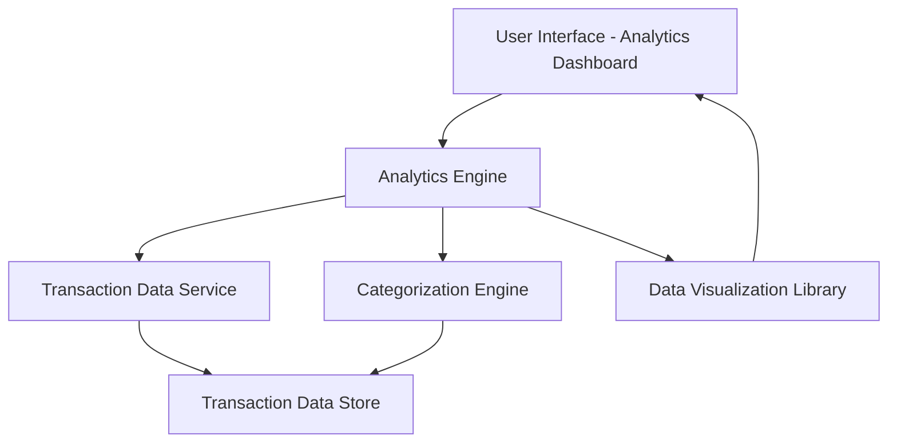

#### 1. High-Level Design

- **Summary:** This epic provides interactive visualizations and analytics for understanding spending patterns across nine categories (Food & Dining, Fuel, Shopping, Travel, Entertainment, Utilities, Healthcare, Education, Miscellaneous). It includes monthly spend trends visualization and transaction categorization to enable data-driven financial decisions.

- **Component Flow:**

- **Integration Points:**
  - **Upstream:** Transaction data service for raw transaction feeds; Categorization engine for transaction classification
  - **Downstream:** Data visualization library for chart rendering

- **Key Assumptions:**
  - Transaction categorization uses rule-based or ML-based engine (approach not specified, assume hybrid with merchant mapping and keyword matching).
  - Monthly spend trends support up to 12 months of historical data with aggregated pre-computed metrics for performance.

- **NFR Highlights:** Analytics charts must render within 1.5 seconds; support interactive filtering and drill-down capabilities; handle transaction data for up to 12 months; ensure accurate categorization of transactions.

#### 2. Validation Report

- **Requirements Coverage:** The design fully covers the stated scope including category-wise spending visualization, monthly spend trends chart, interactive analytics dashboard, nine spending categories tracking, transaction categorization, spending pattern analysis, and visual data representation. The architecture addresses the 1.5-second chart rendering NFR through pre-aggregated data and efficient visualization libraries. The 12-month transaction data handling requirement is supported by the transaction data store with appropriate indexing and query optimization. Interactive filtering and drill-down capabilities are enabled through the analytics engine and visualization library integration. Transaction categorization accuracy is ensured through the dedicated categorization engine component.