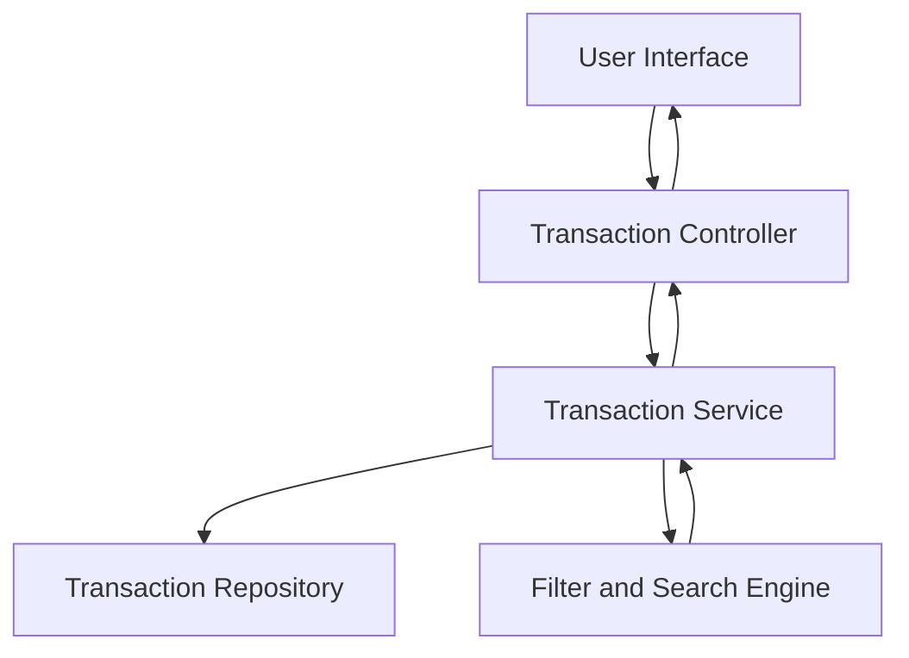

### 1. High-Level Design

**Summary:**  
This epic provides comprehensive transaction management capabilities allowing users to view, search, filter, and track credit card transactions across multiple cards. The solution aggregates transaction history from all user cards into a unified interface with sorting and filtering capabilities, enabling users to maintain accurate spending records and verify charges.

**Component Flow:**

**Integration Points:**
- **Upstream:** Transaction data service or repository providing historical transaction records across multiple credit cards
- **Downstream:** UI components for transaction listing, detail views, and responsive design framework

**Key Assumptions:**
- Transaction data is retrieved via paginated API calls to handle large datasets efficiently (assumed page size of 50-100 transactions)
- Transaction details include standard fields: date, merchant, amount, category, card identifier, and transaction status

**NFR Highlights:**  
Transaction list must load within 3 seconds for up to 1000 transactions; Must handle concurrent user requests efficiently; Accurate data display with proper formatting required

### 2. Validation Report

**Requirements Coverage:**  
The design comprehensively covers all stated requirements including transaction listing, detail views, multi-card aggregation, and responsive interface. The architecture supports the 3-second load time constraint for 1000 transactions through the use of pagination and efficient data retrieval patterns. The filter and search engine component addresses the sorting and filtering requirements. The design acknowledges the need for concurrent request handling and data accuracy, which will be implemented through appropriate service layer patterns and data validation mechanisms.