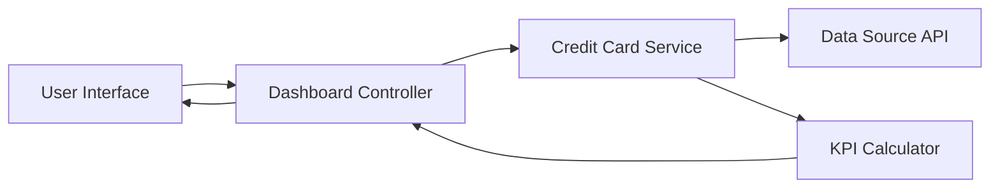

### 1. High-Level Design

**Summary:**  
This epic delivers a consolidated dashboard interface that displays key performance indicators (KPIs) for multiple credit cards, including monthly spend, total credit limit, available credit, and outstanding amounts. The solution enables users to monitor their financial health across all cards from a single, responsive interface accessible on mobile, tablet, and desktop devices.

**Component Flow:**

**Integration Points:**
- **Upstream:** Credit card data source or mock data service providing card details, balances, credit limits, and transaction summaries
- **Downstream:** Responsive UI framework for multi-device rendering; Accessibility compliance libraries for WCAG 2.1 standards

**Key Assumptions:**
- Credit card data will be provided via RESTful API with JSON format containing card metadata and current balance information
- Dashboard refresh frequency is assumed to be on-demand (user-initiated) rather than real-time streaming

**NFR Highlights:**  
Dashboard must load within 2 seconds; Responsive design for mobile, tablet, and desktop; WCAG 2.1 accessibility compliance required

### 2. Validation Report

**Requirements Coverage:**  
The design fully addresses the epic's scope by incorporating all required KPI displays (monthly spend, credit limit, available credit, outstanding amount), multi-card view capability, and responsive layout implementation. The component architecture supports the 2-second load time requirement through efficient service layer design and assumes appropriate caching strategies. Integration with the credit card data source is clearly defined, and accessibility requirements are acknowledged in the design constraints.